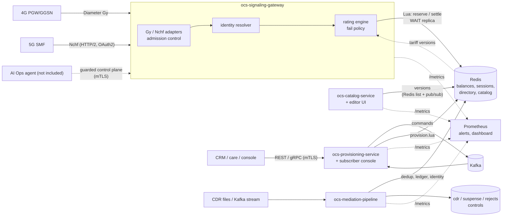

# Meridian OCS

A real-time **online and offline charging system** (OCS/CCS) for mobile networks, written in Go.
It authorises and meters usage for 4G (Diameter Gy/Ro) and 5G (Nchf converged charging) network
elements, keeps balances in a sharded in-memory store with atomic Lua scripts, prices usage from a
versioned tariff catalog, provisions subscribers asynchronously, mediates offline CDRs, and ships
with web consoles, metrics, alert rules, a Helm chart and a one-command local stack.

**Design targets** (not measurements): 50M+ subscribers, ≥ 50,000 TPS, P99 < 10 ms in region,
99.999 % availability, zero double-spend. None of these has been demonstrated yet; see
[What is not built yet](#what-is-not-built-yet).

*Last updated: 2026-10-20, after the local Docker Compose stack. This README is kept current with every
change: see [Keeping this up to date](#keeping-this-up-to-date).*

## Try it

**Everything on one machine (Docker, including Apple Silicon Macs).** Redis primary and replica,
Redpanda (Kafka API), and the gateway, provisioning, catalog, mediation and AI Ops services:

```sh
docker compose up --build     # first start compiles five services
dev/smoke.sh                  # provisions a subscriber, charges it over Nchf, checks mediation and metrics
# consoles:  http://127.0.0.1:8443/ui/  (subscribers)   http://127.0.0.1:8444/ui/  (catalog editor)
docker compose down -v        # stop and forget everything
```

Development only: authentication is off and ports are bound to `127.0.0.1`. Details, ports, what
starts in which order and what was verified: [13 – local stack](docs/architecture/13-local-stack.md).

**Just the consoles, with Go and `redis-server` installed (no Docker):**

```sh
OCS_UI_DEV_ADDR=127.0.0.1:8443 go test -run ServeConsoleForManualTesting -timeout 1h ./services/ocs-provisioning-service
OCS_UI_DEV_ADDR=127.0.0.1:8444 go test -run ServeEditorForManualTesting -timeout 1h ./services/ocs-catalog-service
```

**On Kubernetes:** the Helm chart in `deploy/helm/meridian-ocs`
([12 – deployment](docs/architecture/12-deployment.md)); it has never been installed in a cluster.

## Status

Legend: **built** = implemented, tested and documented, with its gaps listed in its doc (it does not
mean production-ready). The list of what does not exist yet is [further down](#what-is-not-built-yet).

### Charging

| Area | What exists | Doc |
|---|---|---|
| Rating engine and atomic reservations | partitioned workers, reserve/settle/refund in one Redis Lua call, idempotent per session and request number; runs inside the gateway | [03](docs/architecture/03-rating-engine.md) |
| 4G Diameter Gy | RFC 4006 codec and server over TCP, in-house (no third-party Diameter library) | [04](docs/architecture/04-gy-adapter.md) |
| 5G Nchf | converged charging create/update/release over HTTP/2, NRF OAuth2 token validation | [05](docs/architecture/05-nchf-adapter.md) |
| Identity mapping | MSISDN, IMSI and NAI resolve to one subscriber key; unknown or conflicting identifiers are refused, never guessed | [06](docs/architecture/06-identity-mapping.md) |
| Durability | commits wait for replica acknowledgement (`WAIT`); the gateway refuses to start without the replicas it must wait for | [07](docs/architecture/07-durability.md) |
| Fail policy | data tier down: all prepaid refused (fail-closed), postpaid gets small capped grants; circuit breaker | [02](docs/architecture/02-decisions-and-failure-policy.md) |
| Tariff catalog | versioned, compiled, future-datable price plans with a typed condition language, policy filters, offerings and allowances; published atomically and swapped in with no restart; dry-run against the live version | [09](docs/architecture/09-catalog.md) |
| Per-subscriber plans | an attached offering selects the price plan and creates its allowance buckets atomically; never silently falls back to the default plan on a lookup failure | [09](docs/architecture/09-catalog.md), [08](docs/architecture/08-provisioning.md) |
| Offline mediation | BER and JSON CDR files and Kafka records, hardened parser, deduplication, exactly-once output through a ledger, suspense and rejects, optional list-price rating, declarative vendor mappings | [10](docs/architecture/10-mediation.md) |

### Operations and interfaces

| Area | What exists | Doc |
|---|---|---|
| Provisioning | asynchronous commands over REST and gRPC (mTLS), through Kafka to workers; create, top-up, adjust, bundles, buckets, lifecycle, attach offering; idempotency keys; privileged vs standard callers; lookup by MSISDN/IMSI/NAI | [08](docs/architecture/08-provisioning.md) |
| Subscriber console (web) | find a subscriber, create one (with offering and top-up), top up, change offering, correct a balance, change status (termination needs the key typed in); shows only what the caller's certificate allows | [08](docs/architecture/08-provisioning.md) |
| Catalog editor (web) | create and configure offerings and price plans, validate, compare prices against the live version, publish, history and rollback drafts | [09](docs/architecture/09-catalog.md) |
| Metrics and alerts | Prometheus metrics from every service, 28 alert rules (unit-tested with `promtool`), a Grafana dashboard | [11](docs/architecture/11-aiops.md), [12](docs/architecture/12-deployment.md) |
| AI Ops interface | guarded control plane in the gateway (allow-listed, clamped, auto-reverting, two-person rule for risky changes, audited), declarative mapping workbench, structured logs; no agent included | [11](docs/architecture/11-aiops.md) |
| Helm chart | gateway, provisioning (api and worker), catalog, mediation, AI Ops; autoscaling, disruption budgets, spread, optional NetworkPolicy, ServiceMonitor, alert rules, dashboard; refuses insecure choices; values schema; checked in CI | [12](docs/architecture/12-deployment.md) |
| Local stack | `docker-compose.yml` plus a smoke test that runs in CI | [13](docs/architecture/13-local-stack.md) |

Architecture and decisions: [01](docs/architecture/01-system-architecture.md),
[02](docs/architecture/02-decisions-and-failure-policy.md).

## What is not built yet

Honest list, grouped; each module's doc has the detail. Items marked **(next candidate)** are the
ones I would build first.

**Scale, performance and platform**
- **No load test.** The numbers in the docs are micro-benchmarks in a small sandbox (about 110 µs per Redis
  charge call on loopback). 50k TPS and P99 < 10 ms are untested against a real cluster.
- **No Redis Cluster support** (`WAIT` is not available on Cluster) and no Sentinel/operator integration.
- **Redis connections have no password, ACL user or TLS option** (address only). **(next candidate)**
- **No multi-region active-active replication** (design only, doc 01 §6).
- **Standalone `ocs-rating-engine` and `ocs-data-layer` services** are scaffolds; the engine runs in-process in the gateway.
- **The Helm chart has never been installed in a cluster.** No Redis or Kafka in the chart, NetworkPolicy is
  ingress-only, HPA scales on CPU only, no service-mesh topology.
- **Images are built and smoke-tested in CI but not published**, signed or scanned.

**Charging protocols and features**
- Gy: no SCTP, no TLS/IPsec, no Re-Auth/Abort-Session, no relay/redirect/peer table; monetary units and many
  AVPs (Tariff-Change, quota holding time, location) are ignored.
- Nchf: no PEC, notifications/callbacks, triggers, thresholds, or non-PDU charging blocks (SMS, MMTel, NEF);
  no GPSI or feature negotiation; scopes are service-level only.
- Pricing is per request attribute only: no tiered or volume pricing across a billing period, no subscriber-state
  inputs to rules; cash prices are `num/den` with `den ≤ 4096`.
- No automatic Grace → Suspended timer; no reconciler for usage left unsettled when a session is barred mid-flight;
  no profile cache feeding the postpaid fail-open path (with Redis down every request is denied).
- Offering changes reach gateways after a 30 s cache TTL (no push invalidation), and a plan cannot be switched
  without re-creating the offering's allowances.
- Billing, invoicing, payments and a CRM are out of scope for this project.

**Offline mediation**
- The **BER field mapping (PGW-CDR) is from the specification as recalled and unverified** against real network
  files; no SMF-CDR mapping.
- No SFTP/FTP pull, no ClickHouse/S3/Parquet sink; whole files are read into memory (capped at 256 MiB);
  records later than the 72 h duplicate window are not recognised as duplicates; nothing re-drives records held
  in suspense; offline rating is list price on cash for bytes only.

**Consoles and access control**
- No login of its own (it relies on browser client certificates; production would put SSO/OIDC in front).
- **No two-person approval** for balance corrections, termination or catalog publishes. **(next candidate)**
- No bundle/bucket screens, no usage or transaction history, no list or search by name, no bulk actions.
- The catalog version record does not keep the author; the catalog service has no gRPC API.

**Observability and AI Ops**
- No AI Ops agent or anomaly detection, no OpenTelemetry or traces.
- Kafka consumer lag and gRPC calls are not exported as metrics; the admin port is unauthenticated (keep it
  cluster-internal); the control plane exists only in the gateway and is per pod, not per fleet.
- Alerts and the dashboard are validated by tooling, not looked at in a running Prometheus and Grafana.

**Security**
- Kafka connections are plaintext (no TLS/SASL).
- `WAIT` shows a replica received a write, not that it was fsynced; it is not a consensus guarantee.

## How it fits together



Key ideas (details and trade-offs in the docs):

- **One subscriber, one hash slot.** Balances, buckets and sessions for a subscriber share a Redis
  hash tag, so a charge is a single atomic Lua call: settle the previous slice, refund the unused part,
  reserve the next, store the answer for retransmits. Money never moves outside that script.
- **Idempotent everywhere.** Charging is idempotent per `(session, request number)`; provisioning per
  command token; mediation per source position and per unit through a ledger.
- **Fail policy.** If the data tier is unreachable, prepaid is always refused (no balance, no grant);
  postpaid may get a small, journalled, capped grant.
- **Durable by acknowledgement.** Committing steps wait for a replica (`WAIT`) before answering.
- **Versioned tariffs.** Rules are compiled, type-checked and published as append-only versions that
  can be future-dated; rating nodes swap them in atomically with no restart. A subscriber's offering
  (set by provisioning, which also creates its allowance buckets atomically) selects its price plan.
- **No silent security defaults.** Every service refuses to start until its authentication mode is chosen
  (`...AUTH` must be `mtls` or `off`), and the Helm chart refuses the same way.

## Repository layout

```
api/proto/ocs/v1/     protobuf definitions (provisioning and AI Ops APIs, generated into pkg/gen)
pkg/                  shared library module
  canonical/          protocol-independent charging request/response (pooled)
  datalayer/          Redis client, Lua scripts (charge, sweep, provision), WAIT durability, redistest
  engine/             rating engine: partitioned workers, timing wheel, tariff interface
  failpolicy/         hybrid fail-open/closed policy with caps and breaker
  catalog/            tariff catalog model, compiler, versioned store, replication, dry-run (+ expr/)
  identity/           MSISDN/IMSI/NAI -> subscriber key directory, resolver, cache
  diameter/           Diameter codec for Gy (RFC 4006)
  lifecycle/          subscriber lifecycle state machine
  telemetry/          Prometheus-format metrics, latency histogram, HTTP instrumentation, JSON logger
  control/            guarded control plane for AI Ops agents (+ controlrpc gRPC server)
  mapping/            declarative JSON translation rules, hot-reloadable (+ JSON Schema, example)
  tlsconf/ svcenv/ service/   TLS/mTLS helpers, env parsing, service runner
services/             one Go module per service (see go.work); the provisioning and catalog services embed their consoles
build/Dockerfile      builds any service: --build-arg SERVICE=<name>
docker-compose.yml    local development stack (+ dev/: seed catalog, smoke test)
deploy/helm/          Helm chart (values schema, CI value sets, alert rules + tests, dashboard, test.sh)
docs/architecture/    design documents 01-13
.github/workflows/    CI: fmt, vet, build, test (with Redis); protobuf checks; Helm chart checks; local stack smoke test
```

## Build, test, run

Requirements: Go 1.22+, and `redis-server` on the PATH for the integration tests (CI installs it). Set
`OCS_REQUIRE_REDIS=1` to make a missing Redis fail the tests instead of skipping them.

```sh
make fmt vet build test      # whole workspace, race detector on
make proto-tools proto       # regenerate protobuf code (needs buf)
make docker                  # one image per service
make stack-up stack-smoke    # the local stack and its smoke test (make stack-down to stop)
deploy/helm/test.sh          # chart checks (needs helm; kubeconform and promtool are used if installed)
```

Smallest useful gateway run (a local Redis, no replicas, no auth: development only):

```sh
redis-server --port 6379 &
OCS_ORIGIN_HOST=ocs1.example.net OCS_ORIGIN_REALM=example.net OCS_HOST_IP=127.0.0.1 \
OCS_REDIS_REPLICAS=0 OCS_NCHF_OAUTH=off OCS_IDENTITY_MODE=direct \
  go run ./services/ocs-signaling-gateway
curl -i http://127.0.0.1:8080/readyz
```

The gateway refuses to start unless it is told how to authenticate Nchf callers
(`OCS_NCHF_OAUTH`) and, outside development, unless Redis has the replicas it must wait for.
Each service documents its environment variables at the top of its `main.go`/`config.go` and in its doc.

## Testing

- Unit and integration tests run against a **real `redis-server`**, including a primary with a real
  replica (and a frozen one, via SIGSTOP) to prove commits wait for acknowledgement, and an in-memory
  Kafka (`kfake`) for the provisioning and mediation services.
- Concurrency tests hammer one subscriber from many goroutines; the race detector is on in CI.
- Important guarantees were **mutation-checked**: break the guarantee in the code, confirm a test
  fails, restore it. The docs say which.
- Wire formats were checked with independent clients where possible (a separate Diameter client,
  `curl`/`openssl` against the real service binaries). Fuzzing: the expression compiler and the BER reader.
- The consoles are driven in a real Chromium with Playwright (by hand, scripts in
  `services/*/internal/ui/browser-check`): validation, creation, every action, stale-editor refusal,
  markup shown as text, no CSP violations, no horizontal scroll on a phone.
- Chart: `deploy/helm/test.sh` (lint, render, kubeconform, deliberate refusals, pod properties,
  `promtool` and alert unit tests, every metric used is registered in the code), mutation-checked.
- Local stack: `dev/smoke.sh` against the real containers, in CI.

## Documentation

Start with [01 – architecture and sequence flows](docs/architecture/01-system-architecture.md), then the
decisions in [02](docs/architecture/02-decisions-and-failure-policy.md). Each later document describes one
module as built, with measured numbers where they exist and an explicit list of gaps:

| | |
|---|---|
| [03](docs/architecture/03-rating-engine.md) rating engine | [04](docs/architecture/04-gy-adapter.md) Gy adapter |
| [05](docs/architecture/05-nchf-adapter.md) Nchf adapter | [06](docs/architecture/06-identity-mapping.md) identity mapping |
| [07](docs/architecture/07-durability.md) durability | [08](docs/architecture/08-provisioning.md) provisioning and the subscriber console |
| [09](docs/architecture/09-catalog.md) catalog and its editor | [10](docs/architecture/10-mediation.md) offline mediation |
| [11](docs/architecture/11-aiops.md) metrics, control plane, mappings | [12](docs/architecture/12-deployment.md) Helm chart, alerts, dashboard |
| [13](docs/architecture/13-local-stack.md) local Docker Compose stack | |

## Keeping this up to date

Every change that adds, changes or removes a capability updates, in the same pull request: the status
tables and the [not-built list](#what-is-not-built-yet) above (move an item out when it is built, add
what the change leaves undone), the *Last updated* line, the relevant document in `docs/architecture/`
(including its gap list), and the repository layout and test sections if they changed. `CLAUDE.md` states
this rule for automated contributors.
