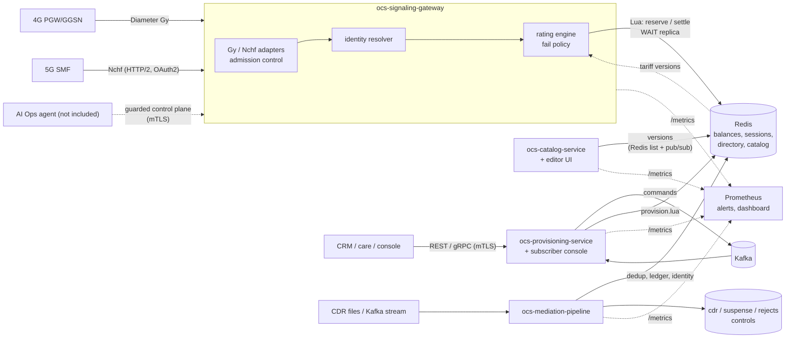

# Meridian OCS

A real-time **online and offline charging system** (OCS/CCS) for mobile networks, written in Go.
It authorises and meters usage for 4G (Diameter Gy/Ro) and 5G (Nchf converged charging) network
elements, keeps balances in a sharded in-memory store with atomic Lua scripts, prices usage from a
versioned tariff catalog, provisions subscribers asynchronously, mediates offline CDRs, and ships
with web consoles, metrics, alert rules, a Helm chart and a one-command local stack.

**Design targets** (not measurements): 50M+ subscribers, ≥ 50,000 TPS, P99 < 10 ms in region,
99.999 % availability, zero double-spend. None of these has been demonstrated yet; see
[What is not built yet](#what-is-not-built-yet) and [Backlog in detail](#backlog-in-detail-parked-work).

*Last updated: 2026-10-20, after the unbuilt work was written up in full detail ([Backlog in detail](#backlog-in-detail-parked-work)) and the project was parked. This README is kept current with every
change: see [Keeping this up to date](#keeping-this-up-to-date).*

## Try it

**Everything on one machine (Docker, including Apple Silicon Macs).** Redis primary and replica,
Redpanda (Kafka API), and the gateway, provisioning, catalog, mediation and AI Ops services:

```sh
docker compose up --build     # first start compiles five services
dev/smoke.sh                  # provisions a subscriber, charges it over Nchf, checks mediation and metrics
# consoles:  http://127.0.0.1:8443/ui/  (subscribers)   http://127.0.0.1:8444/ui/  (catalog editor)
make loadtest                 # 200 charging sessions/s for 20 s, then reconciles every balance
docker compose down -v        # stop and forget everything
```

Development only: the services have authentication off and ports are bound to `127.0.0.1` (Redis does require a password and TLS). Large corrections and terminations are held for two-person approval (see the console's *Approvals* tab; self-approval is allowed here because there is only one identity). Details, ports, what
starts in which order and what was verified: [13 – local stack](docs/architecture/13-local-stack.md).

**Just the consoles, with Go and `redis-server` installed (no Docker):**

```sh
OCS_UI_DEV_ADDR=127.0.0.1:8443 go test -run ServeConsoleForManualTesting -timeout 1h ./services/ocs-provisioning-service
OCS_UI_DEV_ADDR=127.0.0.1:8444 go test -run ServeEditorForManualTesting -timeout 1h ./services/ocs-catalog-service
```

**On Kubernetes:** the Helm chart in `deploy/helm/meridian-ocs`
([12 – deployment](docs/architecture/12-deployment.md)); it has never been installed in a cluster.

## Status

Legend: **built** = implemented, tested and documented, with its gaps listed in its doc (it does not
mean production-ready). The list of what does not exist yet is [further down](#what-is-not-built-yet).

### Charging

| Area | What exists | Doc |
|---|---|---|
| Rating engine and atomic reservations | partitioned workers, reserve/settle/refund in one Redis Lua call, idempotent per session and request number; runs inside the gateway | [03](docs/architecture/03-rating-engine.md) |
| 4G Diameter Gy | RFC 4006 codec and server over TCP, in-house (no third-party Diameter library) | [04](docs/architecture/04-gy-adapter.md) |
| 5G Nchf | converged charging create/update/release over HTTP/2, NRF OAuth2 token validation; checked against TS 32.290/32.291 for retransmission, denied-request usage and unknown sessions (an update or release for a session the store lost is accepted and charged) | [05](docs/architecture/05-nchf-adapter.md) |
| Identity mapping | MSISDN, IMSI and NAI resolve to one subscriber key; unknown or conflicting identifiers are refused, never guessed | [06](docs/architecture/06-identity-mapping.md) |
| Durability | commits wait for replica acknowledgement (`WAIT`); the gateway refuses to start without the replicas it must wait for | [07](docs/architecture/07-durability.md) |
| Redis access control | every service connects with an ACL user and password (inline or from a re-read file, so rotation needs no restart) over verified TLS, optionally with a client certificate; misconfiguration is refused at start-up; the chart will not render an open Redis | [07](docs/architecture/07-durability.md) |
| Fail policy | data tier down: all prepaid refused (fail-closed), postpaid gets small capped grants; circuit breaker | [02](docs/architecture/02-decisions-and-failure-policy.md) |
| Tariff catalog | versioned, compiled, future-datable price plans with a typed condition language, policy filters, offerings and allowances; published atomically and swapped in with no restart; dry-run against the live version | [09](docs/architecture/09-catalog.md) |
| Per-subscriber plans | an attached offering selects the price plan and creates its allowance buckets atomically; never silently falls back to the default plan on a lookup failure | [09](docs/architecture/09-catalog.md), [08](docs/architecture/08-provisioning.md) |
| Offline mediation | BER and JSON CDR files and Kafka records, hardened parser, deduplication, exactly-once output through a ledger, suspense and rejects, optional list-price rating, declarative vendor mappings | [10](docs/architecture/10-mediation.md) |

### Operations and interfaces

| Area | What exists | Doc |
|---|---|---|
| Provisioning | asynchronous commands over REST and gRPC (mTLS), through Kafka to workers; create, top-up, adjust, bundles, buckets, lifecycle, attach offering; idempotency keys; privileged vs standard callers; lookup by MSISDN/IMSI/NAI | [08](docs/architecture/08-provisioning.md) |
| Grace expiry | with `OCS_PROV_GRACE_SWEEP` set, a subscriber whose grace period (given a deadline) has ended is suspended by the service itself: an index kept atomically with the profile, a guarded step that cannot suspend a subscriber who was restored or given longer, safe with several instances and after a crash, `lifecycle.changed` event, five metrics; off by default | [08](docs/architecture/08-provisioning.md#the-end-of-a-grace-period) |
| Two-person approval | privileged changes (large balance corrections, terminations, bucket removals: chosen by one policy setting) wait until a *different* authorised person approves exactly what was requested; decided atomically in Redis, enforced again by the worker, expiring, audited on the events topic, over REST, gRPC and the console | [08](docs/architecture/08-provisioning.md#two-person-approval) |
| Subscriber console (web) | find a subscriber, create one (with offering and top-up), top up, change offering, correct a balance, change status (termination needs the key typed in), and for approvers an Approvals tab; shows only what the caller's certificate allows | [08](docs/architecture/08-provisioning.md) |
| Catalog editor (web) | create and configure offerings and price plans, validate, compare prices against the live version, publish, history and rollback drafts | [09](docs/architecture/09-catalog.md) |
| Metrics and alerts | Prometheus metrics from every service, 36 alert rules (unit-tested with `promtool`), a Grafana dashboard | [11](docs/architecture/11-aiops.md), [12](docs/architecture/12-deployment.md) |
| AI Ops interface | guarded control plane in the gateway (allow-listed, clamped, auto-reverting, two-person rule for risky changes, audited), declarative mapping workbench, structured logs; no agent included | [11](docs/architecture/11-aiops.md) |
| Helm chart | gateway, provisioning (api and worker), catalog, mediation, AI Ops; autoscaling, disruption budgets, spread, optional NetworkPolicy, ServiceMonitor, alert rules, dashboard; refuses insecure choices; values schema; checked in CI | [12](docs/architecture/12-deployment.md) |
| Local stack | `docker-compose.yml` plus a smoke test that runs in CI | [13](docs/architecture/13-local-stack.md) |
| Load test and reconciliation | `tools/ocs-loadgen`: seeds subscribers, drives Nchf sessions at a constant arrival rate (open loop, latency counted from when the arrival was due), then checks every balance against the usage it reported, so lost or created money fails the run; a short run is part of CI; `dev/chaos.sh` repeats it while the Redis replica or primary or the gateway is frozen, stopped or killed (development stack only, not in CI) | [14](docs/architecture/14-load-test.md) |
| Unsettled-usage reconciler | usage reported while Redis is down (in a terminate that is still acknowledged, or in an update that is refused) is first saved to a local fsynced log and charged when Redis returns, idempotently; the data tier remembers which of a session's last 8 requests it applied, so a refused update is charged exactly when it was not applied (including after a retransmission), and one older than that is deliberately left to a person; metrics, four alerts, dead letters kept; the log can live on a persistent volume per pod and is charged for up to a configurable time on shutdown; found and measured by the failure injection; `OCS_UNSETTLED_PEER_REPEATS` switches to the cautious rule if a peer may repeat refused usage | [03](docs/architecture/03-rating-engine.md#usage-released-while-the-data-tier-is-down-and-its-reconciler) |

Architecture and decisions: [01](docs/architecture/01-system-architecture.md),
[02](docs/architecture/02-decisions-and-failure-policy.md).

## What is not built yet

Honest list, grouped; each module's doc has the detail, and [Backlog in detail](#backlog-in-detail-parked-work) turns it into work items. The item marked **(next candidate)** is the
one I would build first.

**Scale, performance and platform**
- **Capacity is unproven.** A load generator exists ([14](docs/architecture/14-load-test.md)) but has only been
  run with the generator and the whole stack sharing one 4-vCPU sandbox, where the system sustained roughly
  1,800 charging requests/s before shedding load. 50k TPS and P99 < 10 ms are untested on real infrastructure; the generator has no
  Diameter Gy mode and no soak, and fault injection covers five faults on the local stack only (no failover, partition or Kafka outage). **(next candidate: a run on dedicated hardware or a cluster)**
- **Unsettled-usage reconciler gaps**: a refused update more than 8 requests behind its session is left uncharged for a person (it could be charged twice);
  the rule assumes a network element does not report refused usage again under a **new** request number: supported for conforming Gy clients by RFC 4006 §9.1 and its client state machine,
  and for Nchf by the text of TS 32.290/32.291 (usage of a denied request "shall be deducted"), but 3GPP TS 32.299 and real PGW/SMF behaviour were not checked, so `OCS_UNSETTLED_PEER_REPEATS=true` gives the cautious behaviour; the Nchf `usedUnitContainer.localSequenceNumber` is deliberately not used for de-duplication (its scope is unspecified and a sender that fills it with a constant would lose revenue silently; [05](docs/architecture/05-nchf-adapter.md));
  the spool survives a replaced pod only in `persistent` mode (a StatefulSet; never attached to a real volume, scaling in strands the removed pods' volumes) and the gateway drains it for up to `OCS_UNSETTLED_DRAIN` on shutdown; a replay is rated at the tariff in effect then;
  dead letters need a human; with `OCS_UNSETTLED_SPOOL=off` the usage is lost (alerted on). See [03](docs/architecture/03-rating-engine.md).
- **No Redis Cluster support** (`WAIT` is not available on Cluster) and no Sentinel/operator integration (the address is a single endpoint).
- Redis access control is coarse: one user and password per release (no least-privilege ACL profile per service), and a rotated CA certificate is read at start-up only.
- **No multi-region active-active replication** (design only, doc 01 §6).
- **Standalone `ocs-rating-engine` and `ocs-data-layer` services** are scaffolds; the engine runs in-process in the gateway.
- **The Helm chart has never been installed in a cluster.** No Redis or Kafka in the chart, NetworkPolicy is
  ingress-only, HPA scales on CPU only, no service-mesh topology.
- **Images are built and smoke-tested in CI but not published**, signed or scanned.

**Charging protocols and features**
- Gy: no SCTP, no TLS/IPsec, no Re-Auth/Abort-Session, no relay/redirect/peer table; monetary units and many
  AVPs (Tariff-Change, quota holding time, location) are ignored.
- Nchf: no PEC, notifications/callbacks, triggers, thresholds, or non-PDU charging blocks (SMS, MMTel, NEF);
  no GPSI or feature negotiation; scopes are service-level only.
- Pricing is per request attribute only: no tiered or volume pricing across a billing period, no subscriber-state
  inputs to rules; cash prices are `num/den` with `den ≤ 4096`.
- The Grace → Suspended timer is off by default, covers only grace periods given a deadline after it was deployed, has no alert rule and was not run in the Docker smoke test or a cluster ([08](docs/architecture/08-provisioning.md#known-gaps)); no reconciler for usage left unsettled when a session is barred mid-flight;
  no profile cache feeding the postpaid fail-open path (with Redis down every request is denied).
- Offering changes reach gateways after a 30 s cache TTL (no push invalidation), and a plan cannot be switched
  without re-creating the offering's allowances.
- Billing, invoicing, payments and a CRM are out of scope for this project.

**Offline mediation**
- The **BER field mapping (PGW-CDR) is from the specification as recalled and unverified** against real network
  files; no SMF-CDR mapping.
- No SFTP/FTP pull, no ClickHouse/S3/Parquet sink; whole files are read into memory (capped at 256 MiB);
  records later than the 72 h duplicate window are not recognised as duplicates; nothing re-drives records held
  in suspense; offline rating is list price on cash for bytes only.

**Consoles and access control**
- No login of its own (it relies on browser client certificates; production would put SSO/OIDC in front), so an approver is identified by certificate name only: two people sharing a certificate are one person.
- Two-person approval covers provisioning only: **catalog publishes** can still be made by one publisher alone, and approval is "one approver is enough" with no notification to approvers (they poll the console or consume `approval.requested` events).
- No bundle/bucket screens, no usage or transaction history, no list or search by name, no bulk actions.
- The catalog version record does not keep the author; the catalog service has no gRPC API.

**Observability and AI Ops**
- No AI Ops agent or anomaly detection, no OpenTelemetry or traces.
- Kafka consumer lag and gRPC calls are not exported as metrics; the admin port is unauthenticated (keep it
  cluster-internal); the control plane exists only in the gateway and is per pod, not per fleet.
- Alerts and the dashboard are validated by tooling, not looked at in a running Prometheus and Grafana.

**Security**
- Kafka connections are plaintext (no TLS/SASL).
- `WAIT` shows a replica received a write, not that it was fsynced; it is not a consensus guarantee.

## Backlog in detail (parked work)

The project is parked here. This section turns the list above into work items someone can pick up cold:
what is missing, why it matters, what already exists to build on, a suggested approach, and how to prove it
works. Sizes (S ≈ days, M ≈ 1–2 weeks, L ≈ weeks, XL ≈ months, for one engineer who knows the code) are my
judgement, **not measurements**. The per-module "Known gaps" lists in `docs/architecture/` remain the
authority for fine detail; this section does not replace them.

**Priority guide.** Anything that gates trusting the system with real money comes first: **A1, A2, A3, A4**.
Then the protocol and data-quality items that real network elements will expose (**B1–B4, D1**). The
console and AI Ops items (**E, F**) are valuable but nothing fails without them.

### How to pick the work back up

1. `git clone` the repository; `main` is the source of truth (every module was delivered as one pull request, #1–#26).
2. Tooling: Go 1.22+, `redis-server` (tests use a real one), Docker with Compose (for the stack), `helm`,
   `kubeconform` and `promtool` (for `deploy/helm/test.sh`), Python 3 with PyYAML (generators).
3. The checks that must pass before a push are in [`CLAUDE.md`](CLAUDE.md): `OCS_REQUIRE_REDIS=1 make fmt vet build test`;
   `deploy/helm/test.sh` when the chart, rules or dashboard change; `dev/smoke.sh` against `docker compose up` when the stack
   changes; `make loadtest` (balances must reconcile) when the charging path changes. CI runs all of them (jobs `go`, `proto`, `helm`, `stack`).
4. Working rules that still apply: authentication modes are chosen explicitly (`off` only on purpose); prepaid fails closed,
   postpaid fails open with caps; commits wait for replica acknowledgement; unknown or conflicting identifiers are refused;
   every guarantee gets a test that fails when the guarantee is broken (a mutation check); generated files (`pkg/gen`,
   `values.schema.json`, `dashboard.json`) are regenerated with their tools; each pull request updates this README and the
   relevant document, and says what was and was not verified.
5. Nothing described below was started, except where "exists" says so.

### A. Proof, scale and platform (the gate to production)

**A1. Capacity and latency on real infrastructure — L.**
- *Missing:* every number in [14](docs/architecture/14-load-test.md) comes from a 4-vCPU sandbox where generator, gateway,
  Redis, Kafka and the other services shared CPUs (about 1,800 charging requests/s before shedding). The targets (50k TPS,
  P99 < 10 ms, 50M+ subscribers) have never been measured.
- *Exists:* `tools/ocs-loadgen` (open-loop, coordinated-omission-aware latency, balance-conservation check, gateway counter
  cross-check, seeding through provisioning), `make loadtest`, `dev/chaos.sh` with five faults.
- *Do:* run generator and system on separate machines (or a cluster) with a Redis topology close to production; sweep rate until
  P99 or shed rate breaks; capture the server-side histograms (not scraped today); find the tail seen at 600 sessions/s
  that is unexplained; profile (`pprof`) and fix what limits one gateway, then measure how it scales with gateways and with Redis shards.
- *Needs:* hardware or a cluster; A3 (a topology to test).
- *Done when:* a published run states hardware, topology, rate, latency percentiles and reconciliation result, and the gap to the targets is known.

**A2. Soak, skew and population tests — M.**
- *Missing:* runs last under a minute, so leaks, slow growth and reservation expiry over hours are untested; seeding is capped at
  99,999 subscribers per run and about 250/s; there is no hot-subscriber (skewed) distribution; only one bucket is reconciled;
  the Kafka event trail and the ledger are not compared with balances.
- *Do:* add a long-run mode (hours) with memory and goroutine tracking, a Zipf-skewed subscriber picker, bulk seeding that bypasses the API,
  multi-bucket reconciliation and an event-trail comparison. Add mixed load (provisioning, catalog publishes, mediation running while charging).
- *Done when:* a 24 h run shows flat memory, zero lost or duplicated charge, and reconciled balances, ledger and events.

**A3. Redis topology: failover, Sentinel/operator, Cluster — XL.**
- *Missing:* the address is a single endpoint; a killed primary is only restarted, never failed over; a promoted replica that lacks an
  acknowledged write is untested; `WAIT` is unavailable on Redis Cluster; the charge script derives keys from `KEYS[1]` rather than declaring
  them (doc 03, item 1); the Grace-deadline index is one key (doc 08). `WAIT` proves a replica *received* a write, not that it fsynced it.
- *Do:* first decide the topology (primary + replicas under Sentinel or an operator, or sharded primaries with per-shard replicas).
  Add a client that discovers the current primary and survives promotion; re-check the durability promise under failover with a
  deliberate fault test (kill the primary after an acknowledged write, promote, verify the write); decide the fsync policy (`appendfsync always`
  versus `everysec`) with measured cost; for sharding, declare keys properly or prove the single-slot property per subscriber.
- *Risks:* this is the item most able to break the "no double spend, no lost charge" promise. Do it with the fault harness built first.
- *Done when:* a failover test loses no acknowledged charge and double-charges none, in repeated runs.

**A4. Install and operate the Helm chart in a real cluster — M.**
- *Missing:* never installed. Scheduling, Services, probes, rollouts, the HPA, PodDisruptionBudgets, the persistent-spool StatefulSet
  with real volumes, NetworkPolicy and the new `OcsSpoolClaimStranded` alert (needs kube-state-metrics) have only been rendered and
  schema-checked. The alerts and dashboard have never been looked at in a running Prometheus and Grafana.
- *Do:* stand up a cluster (kind/k3d for a first pass, a managed cluster for the real one) with Redis and Kafka (not in the chart),
  install with `ci/secure.yaml`, run the smoke test and load test against it, kill pods and nodes, scale in and out (the spool-claim path),
  and fix what breaks. Add egress rules to the NetworkPolicy (Redis, Kafka, NRF), an HPA on custom metrics (TPS, in-flight) or KEDA for workers,
  and a story for the mediation pod's volume.
- *Done when:* the chart installs cleanly from scratch, the alerts fire against real metrics in a drill, and the dashboard renders data.

**A5. Supply chain: publish, sign, scan images — S.**
- *Missing:* images are built and smoke-tested in CI (job `stack`) but not pushed, signed or scanned.
- *Do:* push to a registry on tags, sign (cosign), generate an SBOM, scan (Trivy/Grype) and gate on severity; pin base images by digest; run as non-root (the chart already sets a restrictive security context).

**A6. Least-privilege Redis ACL and rotation — S/M.**
- *Missing:* one Redis user and password per release; no per-service profile (a catalog user that cannot touch balances); a rotated *CA* certificate is read only at start-up.
- *Do:* define ACL profiles per service (gateway: the charge script and reads; provisioning: balance writes; catalog: catalog keys only; mediation: dedup and ledger keys), have the chart create and mount per-service credentials, test that each service fails for what it should not do, and reload the CA on change.

**A7. Standalone engine and data-layer services — M, optional.**
- *Missing:* `ocs-rating-engine` and `ocs-data-layer` are scaffolds; the engine runs in-process in the gateway, which is also what the measured numbers use.
- *Decide first* whether splitting is wanted at all: a network hop costs latency against the 10 ms budget. Build it only if A1 shows the gateway needs independent scaling of the engine. Otherwise delete the scaffolds.

**A8. Multi-region active-active — XL, design only today.**
- *Missing:* doc 01 §6 describes it; nothing is built. The hard part is that a balance is a single-writer fact: either a subscriber has a home region (simplest; remote regions forward or fail by policy) or balances are split into per-region quota slices that are re-balanced. Cross-region replication of catalog and identity is easier and could come first.
- *Do:* write the decision record, choose home-region routing as the first step, build forwarding and the failure policy for a lost home region, then test with injected partitions.

### B. Charging protocols

**B1. Verify against real network elements — M, needs partners or a lab.**
- *Missing:* Gy and Nchf were checked against RFC 4006 and TS 32.290/32.291 text and our own tests, never a real PGW/GGSN/SMF or a conformance suite. TS 32.299 was not read. The assumption that a peer does not report refused usage again under a *new* request number is supported by the specs for Gy and Nchf but unconfirmed on real equipment (`OCS_UNSETTLED_PEER_REPEATS=true` is the cautious setting).
- *Do:* run a Diameter test client/conformance tool against Gy and a 5G core simulator (free5GC/Open5GS SMF/CHF, or vendor) against Nchf; read TS 32.299 for the AVP semantics; capture real traffic into regression tests.

**B2. Gy completeness — M/L.**
- *Missing:* SCTP (`Serve` takes any `net.Listener`, so a SCTP listener plugs in; needs a library or cgo); TLS/IPsec negotiation; Re-Auth-Request and Abort-Session-Request (server-initiated, so the gateway needs a peer table and outbound connections); relay/redirect/proxy behaviour and Destination-Realm/Host validation; monetary units (Cost-Information, CC-Money); AVPs ignored today: Reporting-Reason, Trigger, Tariff-Change-Usage, Time-Of-Change, Quota-Holding-Time/Quota-Consumption-Time, Credit-Control-Failure-Handling, User-Location-Info; same-session CCR ordering holds only for conforming peers.
- *Do, in order:* Tariff-Change and Time-Of-Change (these affect money); Quota-Holding-Time; Re-Auth/Abort (needed for barring a live session, see C3); TLS; SCTP.

**B3. Nchf completeness — L.**
- *Missing:* PEC and the reservation/confirmation flow; notifications/callbacks (`notifyUri`), triggers, thresholds, `quotaHoldingTime`, `announcementInformation`, `sessionFailover`, `invocationResult.failureHandling` in responses (the failure-handling rules were read and the adapter's behaviour documented in doc 05, but it does not set the field); `supportedFeatures` negotiation; GPSI; charging blocks other than PDU session (SMS, MMTel, NEF); fine-grained OAuth scopes, EdDSA tokens, token revocation, per-consumer rate limits and throttling of failed authentication.
- *Do, in order:* `failureHandling` in responses and triggers/thresholds (they change what the SMF does), then SMS, then PEC.
- *Decided against:* de-duplicating on `usedUnitContainer.localSequenceNumber` (doc 05): scope unspecified, and a constant-filling sender would silently lose revenue. Revisit only with a real CTF's behaviour, and as a metric first.

**B4. Identity mapping gaps — S/M.**
- *Missing:* bulk import and a "move this identifier to another subscriber" command; a Gy binding that changes mid-session makes later CCRs resolve to another key; only MSISDN, IMSI and NAI (no GPSI, SIP-URI, private identities); no E.164 normalisation beyond dropping `+`; no push invalidation of the directory cache; no directory hit/miss counters.
- *Do:* a bind-move command with a safe handover rule for open sessions (pin the key in the session as Nchf does), E.164 normalisation per configured country, and directory cache metrics.

**B5. Pricing model — L.**
- *Missing:* pricing sees request attributes only; no tiered or volume discounts across a billing period, no subscriber state (tier, location, accumulated usage) as rule inputs; prices are `num/den` with `den ≤ 4096`, so a price per megabyte cannot be written exactly; offline re-rating uses the subscriber's *current* offering, not the one in force when the record was opened; rated time is processing time.
- *Do:* add accumulated-usage counters to the engine's state (atomic in the Lua script) and expose them as rule inputs; widen the price arithmetic (e.g. 128-bit or scaled integers) with property tests against a big-integer oracle; record the offering and catalog version in the session so re-rating is exact.

**B6. Plan changes without re-creating allowances; push invalidation — S/M.**
- *Missing:* offering changes reach gateways after a 30 s cache TTL; a "switch plan only" command does not exist; an offering id that is removed from the catalog leaves subscribers unpriced.
- *Do:* a plan-switch command in provisioning, an invalidation message (Kafka or Redis pub/sub) the gateways subscribe to, and a guard that refuses to publish a catalog that drops an offering still in use.

### C. Fail-over behaviour and the unsettled-usage safety net

**C1. Postpaid fail-open profile cache — M.**
- *Missing:* the gateway has no profile cache feeding the postpaid fail-open path, so with Redis down every request is denied, which contradicts the standing rule that postpaid fails open with caps.
- *Do:* feed a bounded local cache from provisioning events (Kafka) and from reads, with explicit staleness limits and the caps enforced locally; mutation-test that a prepaid subscriber is never opened by it.

**C2. Reconciler gaps — M.**
- *Missing:* a refused update more than 8 requests behind its session is left for a person; dead letters need a human and there is no console or tool to inspect and resolve them; the spool is node-local unless the chart's `persistent` mode is used (never attached to a real volume); scaling in strands volumes (alerted, not drained automatically); replays are rated at the tariff in effect at replay time.
- *Do:* a dead-letter viewer and resolve command (charge, discard with a reason), an automatic drain of stranded claims (a Job that mounts the orphan claim), and record the rating inputs in the spool record so a replay is priced as it would have been.

**C3. Usage left unsettled when a session is barred mid-flight — S/M.**
- *Missing:* no reconciler for it. Needs Gy Re-Auth/Abort (B2) or an Nchf notification (B3) to actually end the session at the network element.

**C4. Grace → Suspended timer — S.**
- *Missing:* off by default; covers only grace periods given a deadline after it was deployed (earlier ones need one more lifecycle command); the index is a single Redis key; it is node-time based; it has no alert rule; it was never run in the Docker smoke test; a top-up does not return a subscriber to Active.
- *Do:* a migration command that indexes existing Grace subscribers, an alert on overdue count, a smoke-test step, and an auto-return-to-Active rule on top-up.

**C5. Refunds to deleted buckets — S.**
- *Missing:* refunds to a bucket that no longer exists are parked in `P:orph` and nothing reads that hash (doc 03, item 4). Add a reader, an alert on its size and a resolution command.

### D. Offline mediation

**D1. Verify the CDR decoding — M, needs real files.**
- *Missing:* the BER field mapping for PGW-CDR was written from the specification as recalled and is unverified against real network files; no SMF-CDR mapping; vendor file headers/trailers and release-specific extensions are ignored.
- *Do:* obtain sample files from the target vendors, add them as golden tests, fix the mapping, add the SMF-CDR mapping.

**D2. Intake and sinks — M.**
- *Missing:* no SFTP/FTP pull (files must be placed in a directory); only a directory sink (no ClickHouse, S3 or Parquet writer); whole files are read into memory (capped at 256 MiB / 1,000,000 records); mediation is a single pod with no volume failover; Kafka has no TLS/SASL.
- *Do:* an SFTP puller (decide `pkg/sftp` versus a sidecar), a streaming decoder, and the first real sink the customer needs; a lease so two pods cannot take the same file.

**D3. Duplicates, suspense and re-rating — M.**
- *Missing:* records later than the 72 h duplicate window are not recognised as duplicates (the window and ledger live in Redis, so losing them lets a re-sent record through); unmatched records sit in suspense and nothing re-drives them when the subscriber is later provisioned; offline rating is list price on cash for bytes only.
- *Do:* a suspense re-driver triggered by provisioning events, a durable dedup store option, and offline rating for time/events and for allowances (not just cash).

### E. Consoles and access control

**E1. Two-person approval for catalog publishes — M. (My suggested next build.)**
- *Missing:* approval covers provisioning only; a single publisher can publish a catalog that changes every price. The approval machinery (requests, approver identity from the certificate, pending gauges, `approval.requested` events, self-approval refusal, the alert rules) exists in the provisioning service (doc 08) and can be reused or lifted into a shared package.
- *Do:* a publish request that waits for a second identity, a pending-publishes view in the catalog editor, expiry, and tests that a publisher cannot approve their own publish (with a mutation check).

**E2. Real identity — M.**
- *Missing:* the consoles have no login of their own; approvers are identified by certificate name only, so two people sharing a certificate are one person; the catalog version record does not keep the author; no per-user identity in the editor.
- *Do:* put OIDC/SSO in front (or add it), carry the user identity into audit events and the catalog version record, and make approval "one of N" configurable with notification to approvers.

**E3. Console features — M/L.**
- *Missing:* bundle and bucket screens (removing/reloading single buckets); sessions, usage and ledger history on lookup; list and search by name; bulk actions; no gRPC API on the catalog service; no merge for concurrent edits (a stale editor must copy its draft out); no diff of rule contents beyond "changed"; reads by key are not logged.

### F. Observability and AI Ops

**F1. Metrics and tracing gaps — M.**
- *Missing:* OpenTelemetry/traces; Kafka consumer lag and gRPC calls are not exported (the stalled-provisioning alert infers lag from rates); the directory cache has no hit/miss counters; the admin port is unauthenticated (cluster-internal only); the dashboard and alerts have never been seen in a running Prometheus/Grafana (A4).

**F2. Fleet control plane and persistence — M.**
- *Missing:* the control plane exists only in the gateway and is per pod, so replicas can diverge; changes are in memory and lost on restart; auto-revert timers are in-process; the audit ring is bounded (only the JSON log is durable); provisioning, catalog and mediation have no tunables or control listener; mapping rules are JSON-to-JSON for mediation input only (no northbound translation).
- *Do:* a fleet layer that fans a change out to every pod and reports divergence, durable storage of confirmed changes, and authentication on the control and admin ports.

**F3. AI Ops agent and anomaly detection — L, exploratory.**
- *Missing:* only the interface exists (doc 11). Define the signals (latency, shed rate, degraded rate, unsettled-usage rate, balance anomalies), a human-approved action list, and a safe-by-default rollout (recommend only, then act with revert timers).

### G. Security

**G1. Kafka TLS/SASL — S/M.** Connections are plaintext in provisioning, mediation and the event publishers. Add TLS and SASL (SCRAM or mTLS) with explicit modes (no silent default), chart values and tests against a TLS-enabled broker.

**G2. Admin and control-plane authentication — S/M.** The admin port serves metrics and (in the gateway) the control plane without authentication; add mTLS or token auth, and keep the NetworkPolicy as a second layer.

**G3. Durability statement — part of A3.** `WAIT` shows a replica received a write, not that it reached disk, and it is not consensus. If the business needs a stronger statement, this needs a consensus-backed store or synchronous fsync on replicas, with the measured latency cost.

### H. Local stack and developer experience

- No Prometheus/Grafana in `docker-compose.yml` (the chart's alert rules and dashboard are not part of it); listeners have authentication off, so mTLS/OAuth/the caller split are not exercised there (covered by tests and the chart); single Redis primary + replica with no failover; single Redpanda node; **never run on Apple Silicon** (arm64 images exist and the Go code is pure Go, but it was verified on linux/amd64 only); every service image copies the whole repository into its build stage.
- *Do:* add an optional `monitoring` compose profile, a secure compose profile with mTLS, an arm64 CI job, and per-service build contexts.

### Out of scope by decision

Billing, invoicing, payments, dunning and a CRM are not part of this project. The OCS exposes balances, ledger, events and CDR-derived records for those systems to consume.

### Suggested order if work resumes

1. A3 (failover design and fault test) together with A1/A2 (real measurements): these decide whether the core promise holds at scale.
2. A4 and A5 (a real install, signed images), so everything after is tested where it will run.
3. B1 (real peers) and D1 (real CDR files): they will expose what the specs and recollection missed.
4. C1 and C2 (fail-open cache, dead-letter handling), then E1/E2 (approval and identity), G1/G2.
5. B2/B3/B5, D2/D3, E3, F1–F3 as the first customer's needs dictate.

## How it fits together



Key ideas (details and trade-offs in the docs):

- **One subscriber, one hash slot.** Balances, buckets and sessions for a subscriber share a Redis
  hash tag, so a charge is a single atomic Lua call: settle the previous slice, refund the unused part,
  reserve the next, store the answer for retransmits. Money never moves outside that script.
- **Idempotent everywhere.** Charging is idempotent per `(session, request number)`; provisioning per
  command token; mediation per source position and per unit through a ledger.
- **Fail policy.** If the data tier is unreachable, prepaid is always refused (no balance, no grant);
  postpaid may get a small, journalled, capped grant.
- **Durable by acknowledgement.** Committing steps wait for a replica (`WAIT`) before answering.
- **Versioned tariffs.** Rules are compiled, type-checked and published as append-only versions that
  can be future-dated; rating nodes swap them in atomically with no restart. A subscriber's offering
  (set by provisioning, which also creates its allowance buckets atomically) selects its price plan.
- **No silent security defaults.** Every service refuses to start until its authentication mode is chosen
  (`...AUTH` must be `mtls` or `off`), and the Helm chart refuses the same way.

## Repository layout

```
api/proto/ocs/v1/     protobuf definitions (provisioning and AI Ops APIs, generated into pkg/gen)
pkg/                  shared library module
  canonical/          protocol-independent charging request/response (pooled)
  datalayer/          Redis client, Lua scripts (charge, sweep, provision), WAIT durability, redistest
  engine/             rating engine: partitioned workers, timing wheel, tariff interface
  failpolicy/         hybrid fail-open/closed policy with caps and breaker
  catalog/            tariff catalog model, compiler, versioned store, replication, dry-run (+ expr/)
  identity/           MSISDN/IMSI/NAI -> subscriber key directory, resolver, cache
  diameter/           Diameter codec for Gy (RFC 4006)
  lifecycle/          subscriber lifecycle state machine
  telemetry/          Prometheus-format metrics, latency histogram, HTTP instrumentation, JSON logger
  control/            guarded control plane for AI Ops agents (+ controlrpc gRPC server)
  mapping/            declarative JSON translation rules, hot-reloadable (+ JSON Schema, example)
  tlsconf/ svcenv/ service/   TLS/mTLS helpers, env parsing, service runner
tools/ocs-loadgen/    load generator and balance reconciliation (own Go module; see doc 14)
services/             one Go module per service (see go.work); the provisioning and catalog services embed their consoles
build/Dockerfile      builds any service: --build-arg SERVICE=<name>
docker-compose.yml    local development stack (+ dev/: seed catalog, smoke test, failure-injection script)
deploy/helm/          Helm chart (values schema, CI value sets, alert rules + tests, dashboard, test.sh)
docs/architecture/    design documents 01-14
.github/workflows/    CI: fmt, vet, build, test (with Redis); protobuf checks; Helm chart checks; local stack smoke test and a short load test
```

## Build, test, run

Requirements: Go 1.22+, and `redis-server` on the PATH for the integration tests (CI installs it). Set
`OCS_REQUIRE_REDIS=1` to make a missing Redis fail the tests instead of skipping them.

```sh
make fmt vet build test      # whole workspace, race detector on
make proto-tools proto       # regenerate protobuf code (needs buf)
make docker                  # one image per service
make stack-up stack-smoke    # the local stack and its smoke test (make stack-down to stop)
make loadtest                # load + balance reconciliation against the running stack (LOAD_ARGS="-rate 500 ...")
make chaos                   # the same while the replica, the Redis primary or the gateway is broken (dev stack only)
deploy/helm/test.sh          # chart checks (needs helm; kubeconform and promtool are used if installed)
```

Smallest useful gateway run (a local Redis, no replicas, no auth: development only):

```sh
redis-server --port 6379 &
OCS_ORIGIN_HOST=ocs1.example.net OCS_ORIGIN_REALM=example.net OCS_HOST_IP=127.0.0.1 \
OCS_REDIS_REPLICAS=0 OCS_NCHF_OAUTH=off OCS_IDENTITY_MODE=direct OCS_UNSETTLED_SPOOL=off \
  go run ./services/ocs-signaling-gateway
curl -i http://127.0.0.1:8080/readyz
```

The gateway refuses to start unless it is told how to authenticate Nchf callers
(`OCS_NCHF_OAUTH`), whether to keep usage it releases while Redis is down (`OCS_UNSETTLED_SPOOL`: a directory, or
`off` to lose it) and, outside development, unless Redis has the replicas it must wait for.
Each service documents its environment variables at the top of its `main.go`/`config.go` and in its doc.

## Testing

- Unit and integration tests run against a **real `redis-server`**, including a primary with a real
  replica (and a frozen one, via SIGSTOP) to prove commits wait for acknowledgement, and an in-memory
  Kafka (`kfake`) for the provisioning and mediation services.
- Concurrency tests hammer one subscriber from many goroutines; the race detector is on in CI.
- Important guarantees were **mutation-checked**: break the guarantee in the code, confirm a test
  fails, restore it. The docs say which.
- Wire formats were checked with independent clients where possible (a separate Diameter client,
  `curl`/`openssl` against the real service binaries). Fuzzing: the expression compiler and the BER reader.
- The consoles are driven in a real Chromium with Playwright (by hand, scripts in
  `services/*/internal/ui/browser-check`): validation, creation, every action, stale-editor refusal,
  markup shown as text, no CSP violations, no horizontal scroll on a phone.
- Chart: `deploy/helm/test.sh` (lint, render, kubeconform, deliberate refusals, pod properties,
  `promtool` and alert unit tests, every metric used is registered in the code), mutation-checked.
- Local stack: `dev/smoke.sh` against the real containers, in CI.
- Load generator: tested against in-process fakes of the gateway and provisioning, including faulty ones that
  must make it fail (grants not debited, double debit, look-alike sessions); run against the real stack at
  100 to 1,000 sessions/s, including overload (`429` shedding) and a deliberately spent bundle; a short run
  is part of the CI stack job. `dev/chaos.sh` runs it under five injected faults; it found that usage in a terminate during a Redis outage was
  never charged (151 terminates in one 8 s stop), and with the reconciler on every balance reconciled in 12 runs with nothing lost. Measured results and their limits: [14](docs/architecture/14-load-test.md).

## Documentation

Start with [01 – architecture and sequence flows](docs/architecture/01-system-architecture.md), then the
decisions in [02](docs/architecture/02-decisions-and-failure-policy.md). Each later document describes one
module as built, with measured numbers where they exist and an explicit list of gaps:

| | |
|---|---|
| [03](docs/architecture/03-rating-engine.md) rating engine | [04](docs/architecture/04-gy-adapter.md) Gy adapter |
| [05](docs/architecture/05-nchf-adapter.md) Nchf adapter | [06](docs/architecture/06-identity-mapping.md) identity mapping |
| [07](docs/architecture/07-durability.md) durability | [08](docs/architecture/08-provisioning.md) provisioning and the subscriber console |
| [09](docs/architecture/09-catalog.md) catalog and its editor | [10](docs/architecture/10-mediation.md) offline mediation |
| [11](docs/architecture/11-aiops.md) metrics, control plane, mappings | [12](docs/architecture/12-deployment.md) Helm chart, alerts, dashboard |
| [13](docs/architecture/13-local-stack.md) local Docker Compose stack | [14](docs/architecture/14-load-test.md) load test and balance reconciliation |

## Keeping this up to date

Every change that adds, changes or removes a capability updates, in the same pull request: the status
tables and the [not-built list](#what-is-not-built-yet) above (move an item out when it is built, add
what the change leaves undone), the *Last updated* line, the relevant document in `docs/architecture/`
(including its gap list), and the repository layout and test sections if they changed. `CLAUDE.md` states
this rule for automated contributors.
