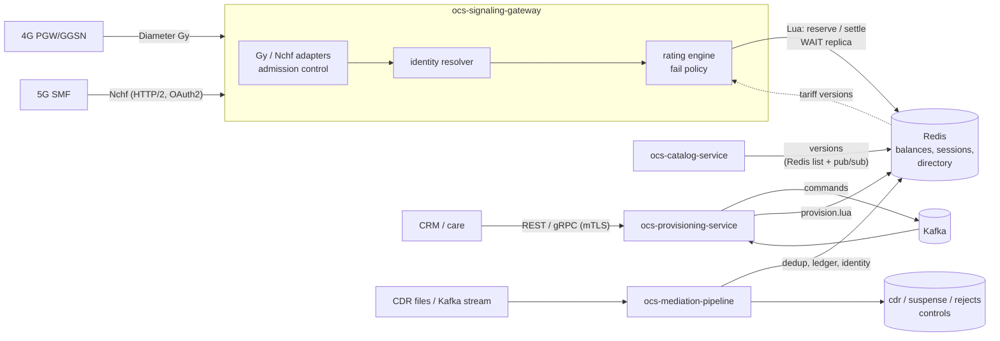

# Meridian OCS

A real-time **online and offline charging system** (OCS/CCS) for mobile networks, written in Go.
It authorises and meters usage for 4G (Diameter Gy/Ro) and 5G (Nchf converged charging) network
elements, keeps balances in a sharded in-memory store with atomic Lua scripts, prices usage from a
versioned tariff catalog, provisions subscribers asynchronously, and mediates offline CDRs.

**Design targets** (not measurements): 50M+ subscribers, ≥ 50,000 TPS, P99 < 10 ms in region,
99.999 % availability, zero double-spend. None of these has been demonstrated yet; see
[What is not done](#what-is-not-done).

## Status

| Module | State | Where | Doc |
|---|---|---|---|
| Architecture & flows | done | `docs/architecture/` | [01](docs/architecture/01-system-architecture.md), [02](docs/architecture/02-decisions-and-failure-policy.md) |
| Rating engine + atomic reservations | done (library, runs inside the gateway) | `pkg/engine`, `pkg/datalayer` | [03](docs/architecture/03-rating-engine.md) |
| 4G Diameter Gy adapter | done | `services/ocs-signaling-gateway/internal/gy`, `pkg/diameter` | [04](docs/architecture/04-gy-adapter.md) |
| 5G Nchf adapter + OAuth2 | done | `services/ocs-signaling-gateway/internal/nchf`, `internal/oauth` | [05](docs/architecture/05-nchf-adapter.md) |
| Subscriber identity mapping | done | `pkg/identity` | [06](docs/architecture/06-identity-mapping.md) |
| Durability (replica-acknowledged commits) | done | `pkg/datalayer/durability.go` | [07](docs/architecture/07-durability.md) |
| Provisioning & lifecycle, subscriber lookup by MSISDN/IMSI/NAI, web console (find, create) | done | `services/ocs-provisioning-service` | [08](docs/architecture/08-provisioning.md) |
| Tariff catalog + per-subscriber plans (offerings) | done | `pkg/catalog`, `services/ocs-catalog-service`, `attach_offering` in provisioning | [09](docs/architecture/09-catalog.md), [08](docs/architecture/08-provisioning.md) |
| Offline CDR mediation | done (BER mapping unverified) | `services/ocs-mediation-pipeline` | [10](docs/architecture/10-mediation.md) |
| Multi-region active-active | design only | doc 01 §6 | |
| AI Ops integration: metrics, guarded control plane, declarative mappings | done for the gateway and mediation (no agent included) | `pkg/telemetry`, `pkg/control`, `pkg/mapping`, `services/ocs-aiops-layer` | [11](docs/architecture/11-aiops.md) |
| Standalone rating-engine / data-layer services | scaffold only (the engine runs in-process in the gateway) | `services/ocs-rating-engine`, `services/ocs-data-layer` | |
| Helm charts (HPA, PDB, anti-affinity, mesh) | not started | `deploy/helm/` (empty) | |

"Done" means implemented, tested (see [Testing](#testing)) and documented, with the gaps for each
module listed at the end of its doc. It does not mean production-ready.

## How it fits together



Key ideas (details and trade-offs in the docs):

- **One subscriber, one hash slot.** Balances, buckets and sessions for a subscriber share a Redis
  hash tag, so a charge is a single atomic Lua call: settle the previous slice, refund the unused part,
  reserve the next, store the answer for retransmits. Money never moves outside that script.
- **Idempotent everywhere.** Charging is idempotent per `(session, request number)`; provisioning per
  command token; mediation per source position and per unit through a ledger.
- **Fail policy.** If the data tier is unreachable, prepaid is always refused (no balance, no grant);
  postpaid may get a small, journalled, capped grant.
- **Durable by acknowledgement.** Committing steps wait for a replica (`WAIT`) before answering.
- **Versioned tariffs.** Rules are compiled, type-checked and published as append-only versions that
  can be future-dated; rating nodes swap them in atomically with no restart. A subscriber's offering
  (set by provisioning, which also creates its allowance buckets atomically) selects its price plan.

## Repository layout

```
api/proto/ocs/v1/     protobuf definitions (provisioning API is generated into pkg/gen)
pkg/                  shared library module
  canonical/          protocol-independent charging request/response (pooled)
  datalayer/          Redis client, Lua scripts (charge, sweep, provision), WAIT durability, redistest
  engine/             rating engine: partitioned workers, timing wheel, tariff interface
  failpolicy/         hybrid fail-open/closed policy with caps and breaker
  catalog/            tariff catalog model, compiler, versioned store, replication, dry-run (+ expr/)
  identity/           MSISDN/IMSI/NAI -> subscriber key directory, resolver, cache
  diameter/           Diameter codec for Gy (RFC 4006)
  lifecycle/          subscriber lifecycle state machine
  telemetry/          Prometheus-format metrics, latency histogram, JSON logger
  control/            guarded control plane for AI Ops agents (+ controlrpc gRPC server)
  mapping/            declarative JSON translation rules, hot-reloadable (+ JSON Schema, example)
  tlsconf/ svcenv/ service/   TLS/mTLS helpers, env parsing, service runner
services/             one Go module per service (see go.work)
build/Dockerfile      builds any service: --build-arg SERVICE=<name>
deploy/helm/          (empty) charts to come
docs/architecture/    design documents 01-11
.github/workflows/    CI: fmt, vet, build, test (with Redis); protobuf lint + generated-code check
```

## Build, test, run

Requirements: Go 1.22+, `redis-server` on the PATH for the integration tests (CI installs it). Set
`OCS_REQUIRE_REDIS=1` to make a missing Redis fail the tests instead of skipping them.

```sh
make fmt vet build test      # whole workspace, race detector on
make proto-tools proto       # regenerate protobuf code (needs buf)
make docker                  # one image per service
```

Smallest useful run (gateway on a local Redis, no replicas, no auth: development only):

```sh
redis-server --port 6379 &
OCS_ORIGIN_HOST=ocs1.example.net OCS_ORIGIN_REALM=example.net OCS_HOST_IP=127.0.0.1 \
OCS_REDIS_REPLICAS=0 OCS_NCHF_OAUTH=off OCS_IDENTITY_MODE=direct \
  go run ./services/ocs-signaling-gateway
curl -i http://127.0.0.1:8080/readyz
```

The gateway refuses to start unless it is told how to authenticate Nchf callers
(`OCS_NCHF_OAUTH`), and, outside development, unless Redis has the replicas it must wait for.
Each service documents its environment variables at the top of its `main.go`/`config.go` and in
its doc. The other services (`ocs-provisioning-service`, `ocs-catalog-service`,
`ocs-mediation-pipeline`) likewise refuse an unset or ambiguous security choice
(`...AUTH` must be `mtls` or `off`).

### Try the console

```sh
OCS_UI_DEV_ADDR=127.0.0.1:8443 go test -run ServeConsoleForManualTesting -timeout 1h ./services/ocs-provisioning-service
# then open http://127.0.0.1:8443/ui/   (in-memory Kafka and a throwaway Redis, authentication off, two sample offerings)
```

## Testing

- Unit and integration tests run against a **real `redis-server`**, including a primary with a real
  replica (and a frozen one, via SIGSTOP) to prove commits wait for acknowledgement, and an in-memory
  Kafka (`kfake`) for the provisioning and mediation services.
- Concurrency tests hammer one subscriber from many goroutines; the race detector is on in CI.
- Important guarantees were **mutation-checked**: break the guarantee in the code, confirm a test
  fails, restore it. The docs say which.
- Wire formats were checked with independent clients where possible (a separate Diameter client,
  `curl`/`openssl` against the real service binaries).
- Fuzzing: the expression compiler and the BER reader.

## Documentation

Start with [01 – architecture and sequence flows](docs/architecture/01-system-architecture.md), then
the decisions in [02](docs/architecture/02-decisions-and-failure-policy.md). Each later document
describes one module as built, with measured numbers where they exist and an explicit list of gaps.

## What is not done

Honest list; each module doc has the detail.

- **No load test.** The performance numbers in the docs are micro-benchmarks in a small sandbox
  (for example ~110 µs per Redis charge call on loopback). 50k TPS / P99 < 10 ms is untested
  against a real cluster.
- **No Redis Cluster deployment**, and `WAIT`-based durability is not available on Cluster.
- **No multi-region replication** is implemented (single-writer-per-subscriber is the design).
- **Offering changes are not pushed**: gateways see a subscriber's new offering after a 30 s cache TTL,
  and there is no command to switch plan without re-creating the offering's allowances.
- **Pricing is per request attribute only**: no tiered or volume pricing across a billing period.
- **Helm charts and the standalone rating/data-layer services** are not built. The AI Ops layer is the
  interface only (metrics, a guarded control plane in the gateway, mapping workbench): there is no agent,
  no OpenTelemetry/traces, and provisioning and catalog expose no metrics.
- **BER CDR field mapping** (PGW-CDR) comes from the specification as recalled and must be verified
  against real network files before use; no SMF-CDR mapping.
- **The web console** covers finding a subscriber and creating one (with offering and top-up). It has no login
  of its own (browser client certificates), and no screens yet for top-ups, lifecycle changes, offering
  changes, catalog editing or usage history.
- **Kafka connections are plaintext** (no TLS/SASL), no SFTP pull for CDR files, no ClickHouse/S3 sink.
- **No automatic Grace → Suspended timer**, no reconciler for usage that could not be settled during
  an outage, and no profile cache feeding the postpaid fail-open path.
