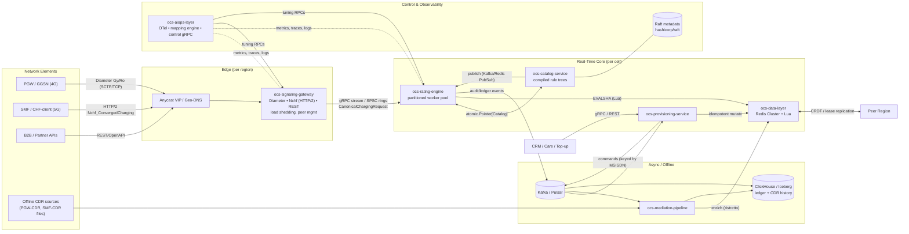
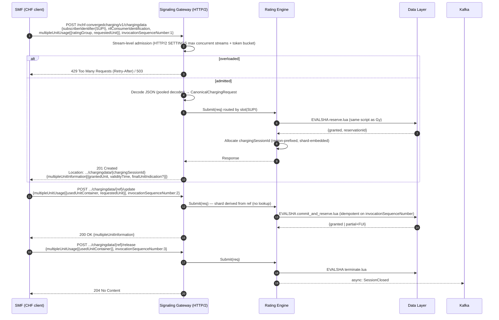
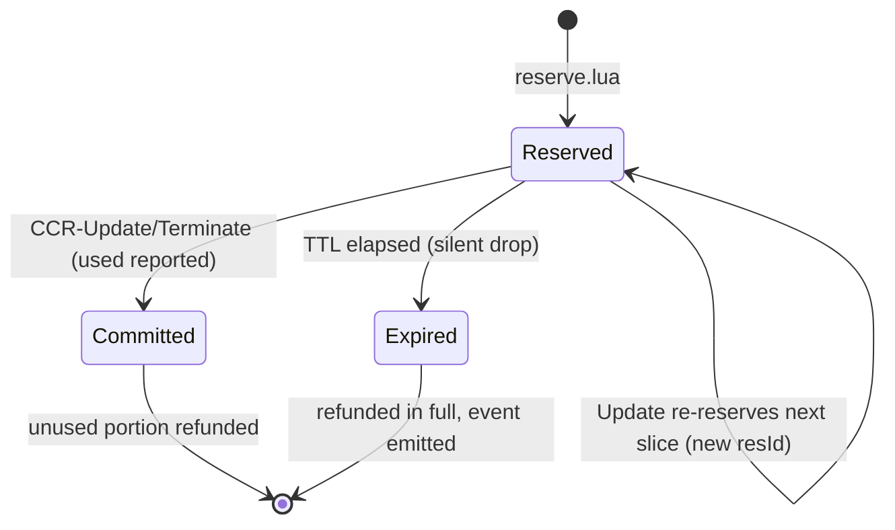
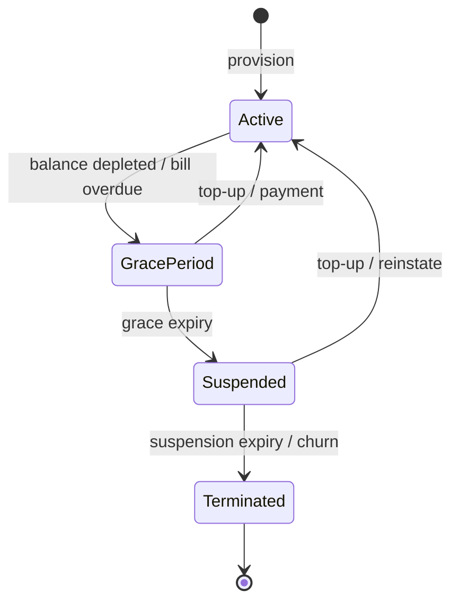

# Meridian OCS — System Architecture & Sequence Flows

| | |
|---|---|
| **Status** | Draft v0.1 — design baseline for scaffolding |
| **Scope** | Real-time Online (Gy/Ro, Nchf) and Offline (CDR) charging, 50M+ subscribers |
| **Language** | Go 1.22+ |
| **Targets** | ≥ 50,000 TPS peak, P99 < 10 ms in-region, 99.999% availability, zero double-spend |

Numbers in this document are **design targets and budgets**, not measurements. Each must be validated by the load-test harness (deliverable 3) before being claimed.

---

## 1. Key Architectural Decisions

| # | Decision | Rationale | Trade-off accepted |
|---|---|---|---|
| D1 | **Single-writer-per-subscriber** (home region + home shard owns all monetary mutations) | Eliminates cross-region write conflicts on balances; the only way to guarantee zero double-spend without distributed transactions in the hot path | Roaming-to-other-region traffic pays an inter-region hop (or uses quota leases, D4) |
| D2 | **Hash-slot sharding on `SubscriberID`** (MSISDN/SUPI → 16,384 slots → shard) end-to-end: gateway routing, worker partitioning, data tier | One subscriber's session, buckets and ledger are co-located; no cross-shard transaction in rating | Hot-key risk for enterprise/shared pools → handled via pool-sub-sharding (§9) |
| D3 | **Redis Cluster + Lua** (or equivalent) for hot state; one Lua call = one atomic *reserve+session+ledger-intent* | Single round trip, atomic, ~100–300 µs server time | Lua scripts must stay O(buckets); durability is AOF-everysec (see §8 risk R1) |
| D4 | **Non-monetary / cross-region data uses CRDTs; monetary debits never do** | PN-counters are safe for commutative top-ups and global counters; debits need a bounded-quota invariant that CRDTs cannot enforce | Cross-region debit for a non-home subscriber uses *quota leases* from home region |
| D5 | **Canonical event model** decouples Diameter/HTTP2/REST from rating | Rating engine is protocol-agnostic and testable | One mapping hop (budgeted < 150 µs) |
| D6 | **Reserve → Commit/Refund** (2-phase at the quota level, 1 atomic op each) | Matches RFC 4006 / TS 32.299 credit-control semantics | Reservation expiry sweeper needed |
| D7 | **Immutable, atomically-swapped catalog** (`atomic.Pointer[Catalog]`) with effective-dated versions | Lock-free reads; time-travel rating without flushes | Memory ×(versions retained) |
| D8 | **Ledger is event-sourced, async to cold store** (Kafka → ClickHouse); hot Redis state is the system of record for *current* balance | Keeps ledger writes off the latency path | Ledger lags by seconds; reconciliation job closes the gap (§8) |

---

## 2. Logical Component View



### Service responsibilities (summary)

| Service | Owns | Does **not** own |
|---|---|---|
| `ocs-signaling-gateway` | Wire protocols, peer FSMs (CER/CEA, DWR/DWA), session routing affinity, admission control | Any charging logic or balances |
| `ocs-rating-engine` | Pipeline execution, quota arithmetic, reservation lifecycle | Catalog authoring, persistence primitives |
| `ocs-catalog-service` | Tariff authoring, validation, dry-run, compiled `Catalog` snapshots | Runtime balance state |
| `ocs-data-layer` | Sharding, Lua scripts, replication hooks, persistence config | Business rules |
| `ocs-provisioning-service` | Lifecycle FSM, idempotency, bulk top-up | Real-time rating |
| `ocs-mediation-pipeline` | CDR decode, dedup, enrichment, store-and-forward | Online balance changes (except rated-late adjustments via provisioning) |
| `ocs-aiops-layer` | Telemetry export, declarative mapping hot-reload, guarded control plane | Autonomous actions without bounds (see §7) |

---

## 3. Latency Budget (in-region, P99)

Total budget **10 ms** (gateway ingress → response written). Budget is allocated with ≥ 25% headroom held back for GC/jitter and tail effects.

| Stage | Budget | Notes |
|---|---:|---|
| NIC → kernel → Go socket read | 0.3 ms | Reuse buffers via `sync.Pool`; no per-message alloc |
| Diameter/HTTP2 decode + canonical map | 0.4 ms | Zero-copy AVP scan; JSON via pre-sized decoder for Nchf |
| Admission control + shard routing | 0.1 ms | Slot lookup is array index |
| Gateway → rating (same pod or intra-AZ gRPC) | 0.8 ms | Co-located mode uses in-process SPSC ring (0.05 ms) |
| Catalog evaluate (compiled tree) | 0.1 ms | Snapshot pointer load + pre-compiled expr |
| Redis Lua round-trip (intra-AZ) | 1.5 ms | Network ~0.4–0.6 ms + script ~0.2 ms + queueing |
| Response build + write | 0.4 ms | Pooled encoders |
| **Subtotal (typical P99 path)** | **≈ 3.6 ms** | |
| Jitter reserve (GC < 1 ms, scheduler, retransmit) | 2.5 ms | |
| **Unallocated safety margin** | **≈ 3.9 ms** | Absorbs cross-AZ replica ack when `WAIT` is used |

**GC policy:** `GOGC` tuned high with `GOMEMLIMIT` set to ~80% of container memory; hot path allocations tracked with `testing.AllocsPerRun` gates in CI (target 0 allocs/op for decode→rate→encode on warm pools).

---

## 4. Sequence Diagram — 4G Gy (Diameter Credit-Control)

Flow: CCR-Initial reserves the first quota; CCR-Update reports usage and reserves the next slice; CCR-Terminate settles and releases. All reservation steps are single atomic Lua operations on the subscriber's shard.

```mermaid
sequenceDiagram
  autonumber
  participant PGW as PGW (PCEF)
  participant GW as Signaling Gateway
  participant RE as Rating Engine
  participant CAT as Catalog Snapshot
  participant DL as Data Layer (Redis+Lua)
  participant K as Kafka (audit/ledger)

  Note over PGW,GW: Peer is already up (CER/CEA done, DWR/DWA keepalive)

  PGW->>GW: CCR-Initial (Session-Id, MSISDN, RG, Requested-Service-Unit)
  GW->>GW: Admission check (token bucket, p99/CPU guard)
  alt overloaded
    GW-->>PGW: CCA 3004 DIAMETER_TOO_BUSY
  else admitted
    GW->>GW: Decode AVPs (pooled buffers) → CanonicalChargingRequest
    GW->>RE: Submit(req) routed by slot(SubscriberID)
    RE->>RE: Partition worker for slot (no lock contention)
    RE->>CAT: Load snapshot; select PricePlan as-of event time
    RE->>DL: EVALSHA reserve.lua(sub, session, RG, unitCost, ttl)
    Note over DL: Atomic: check dedup key → consume promo → bundle → cash<br/>→ create reservation record → write session → append ledger-intent
    DL-->>RE: {granted units, reservationId, balancesDigest}
    RE-->>K: async: ReservationCreated (non-blocking, bounded queue)
    RE-->>GW: CanonicalChargingResponse{Granted, ValidityTime, FUI}
    GW-->>PGW: CCA-Initial (2001, Granted-Service-Unit, Validity-Time)
  end

  Note over PGW: Subscriber consumes data...

  PGW->>GW: CCR-Update (Used-Service-Unit, new Requested-Service-Unit, CC-Request-Number=1)
  GW->>RE: Submit(req)
  RE->>DL: EVALSHA commit_and_reserve.lua(sub, session, reqNo, used, nextReq)
  Note over DL: Idempotent on (session, CC-Request-Number):<br/>retransmit returns the stored answer<br/>Commit used → refund unused of prior reservation → reserve next
  alt balance insufficient for full slice
    DL-->>RE: {partial grant, FinalUnitIndication=true}
    RE-->>GW: Granted(partial) + FUI(TERMINATE or REDIRECT)
  else sufficient
    DL-->>RE: {granted, reservationId'}
  end
  RE-->>GW: response
  GW-->>PGW: CCA-Update (2001 | 4012 CREDIT_LIMIT_REACHED)

  PGW->>GW: CCR-Terminate (final Used-Service-Unit)
  GW->>RE: Submit(req)
  RE->>DL: EVALSHA terminate.lua(sub, session, reqNo, used)
  Note over DL: Commit used, refund remainder, delete session,<br/>emit final ledger entry (single atomic op)
  DL-->>RE: {finalBalances, chargedAmount}
  RE-->>K: async: SessionClosed (rated usage record)
  GW-->>PGW: CCA-Terminate (2001)
```

### Failure semantics for Gy

| Condition | Behaviour |
|---|---|
| Retransmitted CCR (same Session-Id + CC-Request-Number) | Lua returns the **stored previous answer**; no second debit |
| Lost CCA, PGW retries | Same as above — safe by construction |
| PGW silently drops session | Reservation TTL (`Validity-Time` + grace) expires; wheel-timer sweeper + Redis key expiry event refund unused reservation |
| Redis shard unreachable | Gateway returns `3002 UNABLE_TO_DELIVER`/`4010 END_USER_SERVICE_DENIED` per configured *fail policy* (`fail-closed` default for prepaid; `fail-open-with-cap` available for postpaid/hybrid) |
| Late CCR-Update after TTL refund | Treated as a fresh reservation attempt; used units beyond refund are charged via a **rated-late adjustment** (may drive balance negative within an overdraft bound) |

---

## 5. Sequence Diagram — 5G Nchf_ConvergedCharging (TS 32.290/32.291)

Resource lifecycle: `POST /chargingdata` (create) → `POST /chargingdata/{ref}/update` → `POST /chargingdata/{ref}/release`.



**Design notes specific to 5G**

- `chargingSessionId` **embeds region + slot** (`<region>-<slot>-<ulid>`), so update/release can be routed to the owning shard with no directory lookup and can be redirected to the home region if the request lands elsewhere (HTTP 307 with `Location`, per SBA redirect conventions).
- `invocationSequenceNumber` plays the role of `CC-Request-Number`; the same idempotency script handles both protocols (single rating code path → single set of invariants to prove).
- HTTP/2 concurrency is bounded per connection **and** globally; HPACK table size capped to prevent memory amplification.

---

## 6. Sequence Diagram — Multi-Region Active-Active Synchronisation & Failover

### 6.1 Steady state: home-region ownership with async replication

```mermaid
sequenceDiagram
  autonumber
  participant NE as Network Element
  participant GA as Region A Gateway/Rating
  participant DA as Region A Data (HOME of sub X)
  participant REP as Replication Stream (A↔B)
  participant DB as Region B Data (replica of X)
  participant GB as Region B Gateway/Rating

  Note over NE,GB: Case 1 — Subscriber X is homed in A, traffic arrives in A (common case)
  NE->>GA: CCR / Nchf create
  GA->>DA: reserve.lua (authoritative write)
  DA-->>GA: granted
  GA-->>NE: answer (< 10 ms)
  DA-)REP: async: balance delta + session snapshot (ordered per subscriber, with HLC timestamp)
  REP-)DB: apply (idempotent, per-subscriber ordering)

  Note over NE,GB: Case 2 — X's traffic arrives in B (roaming / Anycast spill)
  NE->>GB: CCR / Nchf create
  GB->>GB: Resolve home(X) = A via slot map
  alt Quota lease available in B for X
    GB->>DB: reserve.lua against leased quota slice
    GB-->>NE: answer (local latency)
  else No lease
    GB->>GA: forward over inter-region gRPC (mTLS)
    GA->>DA: reserve.lua (also grants a lease slice to B)
    GA-->>GB: granted + lease
    GB-->>NE: answer (+ inter-region RTT)
  end

  Note over NE,GB: Case 3 — Top-up / global counters (commutative)
  GA->>DA: TopUp(+500) as PN-counter increment, op-id = uuid
  DA-)REP: op replicated
  REP-)DB: merge (G-set of op-ids ⇒ idempotent; counters converge)
```

### 6.2 Failover: Region A lost

```mermaid
sequenceDiagram
  autonumber
  participant HC as Health/Quorum (Raft + external witness)
  participant DNS as Anycast / Geo-DNS
  participant NE as Network Elements
  participant GB as Region B
  participant DB as Region B Data

  HC->>HC: Region A heartbeats lost > T_detect (≈3 s)
  HC->>HC: Witness (3rd site) confirms A unreachable → quorum for epoch N+1
  HC->>DB: Promote B as owner of A-homed slots (fencing epoch N+1)
  HC->>DNS: Withdraw A prefixes (BGP) / zero A weight
  NE->>GB: Traffic converges to B (Diameter peers re-establish; SBA retries)
  NE->>GB: CCR-Update for sessions created in A
  GB->>DB: lookup session → found (replicated) OR not found
  alt Replicated session snapshot present
    DB-->>GB: continue session; reservation preserved
  else Not replicated (replication lag window)
    GB-->>NE: 5002 UNKNOWN_SESSION_ID / 404 → NE re-initiates (new CCR-Initial / create)
    GB->>DB: reserve against replica balance (may be up to RPO stale)
  end
  Note over DB: Orphaned A-side reservations are accounted from the last replicated state;<br/>unreplicated debits (RPO window) are recovered at failback by reconciliation (§8, R2)
  Note over HC: On A recovery: A is fenced (epoch N) until it catches up from B's stream, then slots are handed back
```

**Split-brain protection**

1. Slot ownership is a **fenced lease** (monotonic epoch) stored in Raft metadata; data-tier writes carry the epoch and stale-epoch writes are rejected.
2. A third-site **witness** breaks ties so that a partitioned minority cannot self-promote.
3. A region that cannot reach quorum **stops accepting monetary writes** for slots it doesn't provably own (fail-closed), accepting only commutative top-ups into a local journal.

---

## 7. Rating Pipeline & Concurrency Model (Engine Internals)

```mermaid
flowchart LR
  A["Canonical<br/>Request"] --> B["Identify Subscriber<br/>(slot = crc16(id) % 16384)"]
  B --> C["Partition Queue<br/>(SPSC ring per worker)"]
  C --> D["Fetch Session Ctx<br/>(Lua read-through)"]
  D --> E["Acquire Balance Lock<br/>(= single-writer worker, no mutex)"]
  E --> F["Calculate Unit Cost<br/>(catalog snapshot eval)"]
  F --> G["Reserve / Debit<br/>(Lua: promo → bundle → cash)"]
  G --> H["Update Session State"]
  H --> I["Emit Audit Event<br/>(bounded async queue)"]
```



- **"Balance lock" is structural, not a mutex:** each worker goroutine owns a disjoint set of slots; all requests for a subscriber are serialised through its worker's queue. Cross-process safety is provided by the Lua script's atomicity.
- **CAS vs. Lua:** `atomic.CompareAndSwapInt64` is used for *in-process* counters (token buckets, local leases, quota-lease caches). Authoritative balances are mutated only inside Lua so that bucket debit + reservation + ledger-intent are one atomic unit.
- **Consumption order:** non-expiring promo → bundle allowance (earliest-expiry-first) → primary cash, per catalog `AllowanceBucket.priority`.
- **Pooling:** `CanonicalChargingRequest/Response`, decode buffers and AVP index arrays come from `sync.Pool`; objects are reset on `Put`, and requests are *never retained* past response write (enforced by ownership comments + `-race` + alloc-gate tests).
- **Bounded queues everywhere:** full queue ⇒ shed (3004/429) rather than grow memory.

---

## 8. Data Model, Integrity & Known Risks

### Hot-state keys (per subscriber, same hash-tag ⇒ same slot)

```
{sub:<id>}:bal:<bucketId>     -> int64 minor units (+expiry metadata)
{sub:<id>}:res:<resId>        -> reservation {bucket debits[], expiresAt}
{sub:<id>}:sess:<sessionId>   -> session state (lastReqNo, lastAnswer, rg state)
{sub:<id>}:idem:<opId>        -> provisioning idempotency token (TTL ≥ 7d)
```

Monetary values are **fixed-point int64** (never float); rounding rules are defined per rate plan.

### Invariants (to be enforced by property-based tests)

1. Σ(bucket balances) + Σ(open reservations) + Σ(committed charges) is conserved across any interleaving of reserve/commit/refund/expire.
2. A given `(session, request-number)` mutates balance **at most once**.
3. A bucket never goes below its configured floor except via an explicit overdraft-adjustment path.

### Risks and open issues (honest list)

| ID | Risk | Mitigation / decision needed |
|---|---|---|
| **R1** | **Redis AOF `everysec` can lose up to ~1 s of acknowledged writes on node failure**, which conflicts with the "zero dropped revenue / strict ACID" requirement. | Options: (a) `WAIT 1` for a synchronous replica ack on commit/terminate paths only (+0.3–0.8 ms, intra-AZ); (b) switch the monetary ledger tier to ScyllaDB/VoltDB with synchronous replication. **Recommend (a) for reservations' commit path and reconciling from Kafka session-record stream for the remainder; needs stakeholder sign-off on RPO.** |
| **R2** | Cross-region async replication ⇒ non-zero RPO on region loss (seconds). Pure active-active with CRDTs cannot prevent overspend. | Single-writer-per-sub (D1) + quota leases (D4); accept bounded overdraft = `lease size × active sessions`; reconcile at failback. |
| **R3** | Five nines (5.26 min/yr) is below the likely failure-detection + convergence time of a regional BGP failover if used repeatedly. | Prefer *intra-region* cell redundancy for the bulk of failures; region failover is for disasters. Budget: detect ≤ 3 s, converge ≤ 30 s. |
| **R4** | Go GC target "< 1 ms pauses" is achievable but needs enforcement. | Heap size cap (`GOMEMLIMIT`), alloc gates, pprof/`runtime/metrics` pause histograms exported by `ocs-aiops-layer`; alert on pause P99. |
| **R5** | Hot subscriber / shared pool (enterprise or family bucket) breaks D2 uniformity. | Pool-sub-sharding: pool balance split into N sub-buckets across slots with periodic rebalancing. Needs design in Module 6. |
| **R6** | AI Ops control plane can mis-tune a production charging path. | Bounded, allow-listed parameters; per-call min/max clamps; two-person/approval mode for risky actions; automatic rollback timer; full audit trail (Module 8). |
| **R7** | The prompt's mention of "Uber's `ratelimit`" refers to a leaky-bucket limiter, which is not adaptive. | Use `golang.org/x/time/rate` for static limits + a custom AIMD/Gradient adaptive limiter driven by latency (documented in Module 1). |

---

## 9. State Machines

### 9.1 Reservation



### 9.2 Subscriber lifecycle (Module 5)



Every transition emits a notification event; illegal transitions are rejected by a table-driven FSM and are idempotent on `transitionId`.

---

## 10. Next Steps (Deliverable 2 — Repository Scaffolding)

Proposed `go.work` layout:

```
meridian-ocs/
├── go.work
├── api/proto/              # canonical.proto, rating.proto, provisioning.proto, aiops.proto
├── pkg/                    # shared: canonical model, pools, slotmap, otel helpers
├── services/
│   ├── ocs-signaling-gateway/
│   ├── ocs-rating-engine/
│   ├── ocs-catalog-service/
│   ├── ocs-mediation-pipeline/
│   ├── ocs-provisioning-service/
│   ├── ocs-data-layer/       # Lua scripts + Go client
│   └── ocs-aiops-layer/
├── deploy/helm/              # charts, HPA, PDB, anti-affinity, mesh topology
├── build/                    # Dockerfiles, Makefile
└── docs/architecture/
```

**Decisions requested before scaffolding** (defaults in bold will be used if unanswered):

1. Hot store: **Redis Cluster + Lua** vs. ScyllaDB/VoltDB (see R1).
2. Diameter stack: **in-house minimal Gy codec** (zero-alloc, scoped to CCR/CCA/CER/CEA/DWR/DWA) vs. integrating `fiorix/go-diameter`.
3. Message bus: **Kafka (franz-go client)** vs. Pulsar. (`sarama` is in maintenance mode; `franz-go` is recommended.)
4. Fail policy default on data-tier outage: **fail-closed**.
