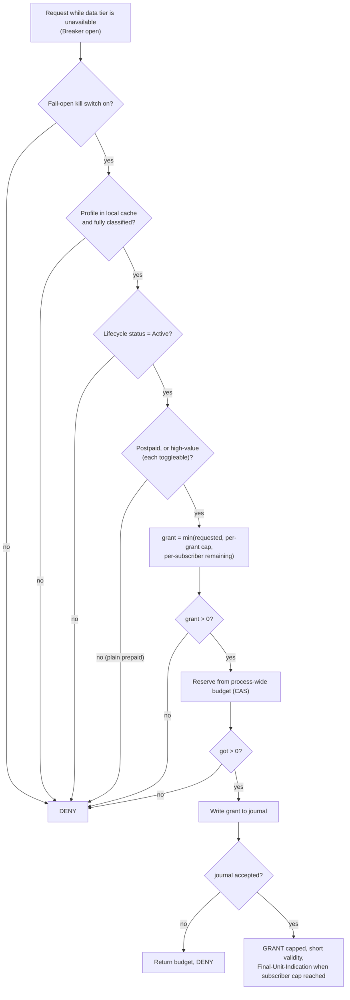

# Decisions & Hybrid Failure Policy

## Decisions (accepted)

| # | Decision | Choice |
|---|---|---|
| 1 | Hot store | **Redis Cluster + Lua**; `WAIT 1` on commit/terminate paths (RPO sign-off still open, see R1 in doc 01) |
| 2 | Diameter stack | **In-house minimal Gy codec** (zero-alloc); `go-diameter` may be used for an interop prototype only |
| 3 | Message bus | **Kafka via `franz-go`** |
| 4 | Data-tier failure policy | **Hybrid** — prepaid fail-closed; postpaid and high-value fail-open with a cap (below) |

## Hybrid failure policy

Implemented in `pkg/failpolicy` (`Engine`, `Breaker`).

### Properties

- **Deny by default.** An unknown subscriber, an incomplete profile, or a non-Active lifecycle state is always denied. Fail-open applies only after positive classification.
- **Bounded leakage.** Worst case per outage epoch = min(per-subscriber cap × eligible subscribers, process-wide cap) × number of processes. Both caps are per unit kind (bytes, seconds, events). The process-wide budget is enforced with a CAS loop and verified under `-race` (`TestGlobalBudgetNeverExceededConcurrently`).
- **Never untracked.** Each grant is written to a journal before it is returned. If the journal rejects the entry (e.g. buffer full) the grant is denied and the budget reservation is returned. `Grant.Prepaid` tells reconciliation to debit the wallet. Postpaid usage is billed from the CDR path.
- **Short grants.** Validity defaults to 30 s so the network element comes back and retries the data tier soon after recovery. Fail-open grants are marked `degraded` in the canonical response.
- **No network in the decision path.** Class comes from a local profile cache that the gateway/rating nodes keep warm. Decision cost is ~100 ns, 0 allocations (`BenchmarkDecide`).
- **Epochs.** `Breaker.onOpen → Engine.BeginOutage` starts a new epoch and resets counters, so a long-lived process does not stay capped from a previous outage.
- **Runtime control.** `Engine.SetConfig` publishes a new immutable `Config` atomically, which is the hook for the AI Ops control plane (it must clamp values server-side).

### Points to confirm

1. **High-value prepaid is fail-open as requested, but it is not "billed later".** Usage is recovered only by reconciliation of the journal against the wallet, so it can drive a balance negative or go unrecovered if the subscriber is empty. `AllowHighValue=false` limits fail-open to postpaid. Treat the high-value caps as the actual revenue-risk limit.
2. **Profile cache freshness.** A subscriber changed to prepaid, suspended or terminated just before an outage is judged on the cached copy. Bound staleness (TTL plus push invalidation from provisioning) when the cache is built.
3. **Per-process budgets.** Global caps are per process, not cluster-wide, since no shared store is reachable during an outage. Size them as (cluster budget ÷ replicas).
4. **Journal durability.** `ChanJournal` is an in-memory buffer; the real implementation must drain it to durable storage (local WAL + Kafka). A process crash can lose buffered entries.

### Wire mapping (gateway)

| Decision | Diameter Gy | Nchf |
|---|---|---|
| Granted | CCA 2001 + short Validity-Time | 201/200 with `grantedUnit`, `validityTime` |
| Granted, last slice | as above + Final-Unit-Indication (TERMINATE) | `finalUnitIndication` |
| Denied (fail-closed) | CCA 4010 END_USER_SERVICE_DENIED (3002 if the gateway itself cannot route) | 503 with `Retry-After` |
