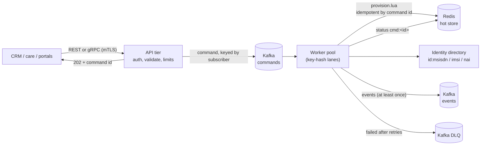

# Provisioning Service

`services/ocs-provisioning-service` is the control-plane write path: it creates
subscribers, tops up and adjusts balances, attaches bundles and moves
subscribers through the lifecycle. It never touches the charging hot path
directly; every change goes through the same atomic Redis scripts the rating
engine uses, so a provisioning change and a charging request can never
interleave inside one subscriber.

## Why asynchronous

A top-up during a Redis failover must not be lost and must not block the CRM.
The API tier validates and authorizes, writes the command to Kafka and answers
`202 Accepted` with a command id. Workers apply it when the data tier is
reachable, and callers poll `GET /v1/commands/{id}` (or consume the event).
Kafka keying by subscriber gives per-subscriber ordering; the worker pool hashes
the key to a lane so two commands for one subscriber are never applied
concurrently.

## Exactly-once effect from at-least-once delivery

- The caller's `Idempotency-Key` (REST header, gRPC field) is the command id.
  Re-submitting returns the original command; re-using the key with a different
  body is rejected (`409` / `ALREADY_EXISTS`) by comparing a fingerprint.
- `provision.lua` stores the outcome of every command id, failures included, so
  a redelivery returns the stored result and never applies twice.
- Offsets are committed only after the whole polled batch is applied, so a crash
  re-applies at most that batch, and the script de-duplicates it.
- Events are at least once. Consumers de-duplicate on `(commandId, type)`.
- Commands that keep failing for infrastructure reasons are retried with
  back-off; a poison command goes to the DLQ and the batch moves on.

## Operations

| Operation | REST | Privileged |
|---|---|---|
| create subscriber | `POST /v1/subscribers` | no |
| top up | `POST /v1/subscribers/{key}/top-ups` | no |
| attach bundle | `POST /v1/subscribers/{key}/bundles` | no |
| set / reload bucket | `PUT /v1/subscribers/{key}/buckets/{bucket}` | no |
| adjust balance (signed) | `POST /v1/subscribers/{key}/adjustments` | **yes** |
| remove bucket | `DELETE /v1/subscribers/{key}/buckets/{bucket}?force=true` | **yes** |
| change lifecycle | `POST /v1/subscribers/{key}/lifecycle` | **yes** |
| attach offering | `POST /v1/subscribers/{key}/offering` | no |
| command status | `GET /v1/commands/{id}` | no |
| read subscriber | `GET /v1/subscribers/{key}` | no |

The same operations exist on the gRPC `ProvisioningService`
(`api/proto/ocs/v1/provisioning.proto`, generated code in `pkg/gen`).

Requests are strict: unknown JSON fields are rejected (a typo such as `amout`
must not become a silent zero top-up), amounts are positive integers in minor
units, and per-call ceilings apply (`OCS_PROV_MAX_TOPUP`,
`OCS_PROV_MAX_ADJUST`). Errors use `{"error":{"code","message"}}`.

### Create subscriber

Creating a subscriber binds its identifiers (MSISDN, IMSI, NAI) in the
directory (doc 06). A conflict (an identifier already owned by another
subscriber) fails the command with `identifier_conflict` and releases only the
bindings this command had just made, so a retry is clean.

### Offerings (price plan and allowances)

`attach_offering` (`{"offering": "gold-offer", "renew": false}`) puts the
subscriber on a catalog product offering (doc 09). Two things happen in **one
atomic script** (`provision.lua`, op `P`): the offering id is stored on the
subscriber's profile, and the offering's allowance buckets are created. Either
all of it applies or none: if any allowance bucket already exists (or exists
with another class) nothing is written and the command fails with
`allowance_exists`. `renew: true` resets existing allowance buckets to their
full amount and expiry instead (a monthly renewal) and also switches the
offering.

The API tier resolves the offering from the catalog version in effect **when the
command is accepted** and puts the resulting allowances (amount, class, unit,
order, absolute expiry = acceptance time + validity days) into the command, so
what is queued is exactly what will be applied, and a redelivery after a catalog
change applies the same thing. The idempotency fingerprint covers only what the
caller asked for (subscriber, offering, renew), so a retry after a catalog change
is the same request, not a conflict. With no catalog in effect the API answers a
retryable `503 catalog_unavailable` (gRPC `UNAVAILABLE`); an offering that is not
in the catalog is `400`.

Bucket ids are the allowance ids of the catalog, so two offerings that use the
same allowance id share a bucket (renewal resets it). Keep ids unique per
purpose. The offering decides the price plan used to rate the subscriber
(doc 09), seen by gateways within `OCS_PLAN_CACHE_TTL` (30 s).

### Lifecycle

`Active -> Grace -> Suspended -> Terminated`, with recoveries back to Active
(doc 03). The change is atomic with the charging scripts: once a subscriber is
Suspended or Terminated, `charge.lua` answers `BARRED` for new quota while still
settling usage from sessions already open.

## Authorization

Authentication is mTLS; the caller identity is the client certificate CN
(`OCS_PROV_CLIENTS` lists standard callers, `OCS_PROV_PRIVILEGED` the callers
allowed the privileged operations). An empty standard list admits any verified
client for standard operations. `OCS_PROVISIONING_AUTH` must be set explicitly to
`mtls` or `off`; the service refuses to start otherwise, so a missing variable
can never silently open the API. `off` is for local development only.
Unauthenticated callers get `401`/`UNAUTHENTICATED`, authenticated callers
without the right get `403`/`PERMISSION_DENIED`.

## Events

Topic `OCS_KAFKA_EVENTS_TOPIC`, key = subscriber, JSON, `v: 1`:

| type | when | extra fields |
|---|---|---|
| `subscriber.provisioned` | create applied | `payment`, `version` |
| `balance.modified` | top-up, adjustment, bundle, bucket set/remove | `bucket`, `delta`, `balance`, `reason` |
| `lifecycle.changed` | lifecycle change applied | `from`, `to`, `reason` |
| `offering.changed` | offering attached or renewed | `from`, `to` (offering ids; `from` empty if none), `buckets` |
| `command.failed` | business failure (e.g. insufficient balance, conflict) | `outcome`, `message` |

## Configuration

| Variable | Meaning | Default |
|---|---|---|
| `OCS_PROV_MODE` | `all`, `api` or `worker` | `all` |
| `OCS_KAFKA_BROKERS` | brokers | required |
| `OCS_CURRENCY` | currency of monetary buckets | required |
| `OCS_PROVISIONING_AUTH` | `mtls` or `off` | required |
| `OCS_PROV_TLS_CERT` / `_KEY` / `OCS_PROV_CLIENT_CA` | server cert and client CA | required for `mtls` |
| `OCS_PROV_CLIENTS`, `OCS_PROV_PRIVILEGED` | allowed CNs | any / none |
| `OCS_PROV_REST_ADDR`, `OCS_PROV_GRPC_ADDR` | listeners | `:8443`, `:9443` |
| `OCS_PROV_WORKERS` | key-hash lanes | 16 |
| `OCS_PROV_MAX_TOPUP`, `OCS_PROV_MAX_ADJUST` | per-call ceilings | 10,000,000 / 1,000,000 |
| `OCS_KAFKA_COMMANDS_TOPIC`, `_EVENTS_TOPIC`, `_DLQ_TOPIC`, `_GROUP` | topics and consumer group | built-in names |
| `OCS_REDIS_ADDR` (catalog) | the catalog is read from the same Redis; the service follows new versions on its own and starts without one | |
| `OCS_IDENTITY_PREFIX` | identity directory key prefix; must match the gateway | `id:` |

Durability env (replica `WAIT`) is shared with the gateway through
`pkg/svcenv`.

## Verification

- Unit tests per package: command validation and fingerprinting, status store,
  authorizer, REST (strict decoding, status codes, mutation-checked), gRPC
  (status mapping, principal from peer cert), service, worker apply/events.
- `e2e_test.go`: REST and gRPC over real mTLS -> in-process Kafka (kfake) ->
  workers -> real `redis-server`, then the charging path: a suspended subscriber
  gets `ItemBarred`.
- Smoke of the real binary against a standalone broker and Redis, driven by
  `curl`/`openssl`: config refusals, create -> applied, top-up -> balance 2500,
  standard caller denied a privileged op (403), no client certificate refused,
  directory and balance visible in Redis.
- Test pins: franz-go v1.18.1 with the matching kfake pseudo-version (newer
  releases raise the module's Go version).

## Known gaps

- Kafka connections are plaintext: no TLS or SASL to the brokers yet.
- The fail-policy profile cache is not yet fed from provisioning events, so the
  postpaid fail-open path has no live profile source (doc 02, point 1).
- No sweeper moves Grace -> Suspended on a timer; today an operator or upstream
  system issues the lifecycle command.
- No reconciler for usage left unsettled when a session is barred mid-flight.
- The command status store is advisory (TTL-bound); the idempotency record in
  the hot store is the source of truth.
- Events are at least once, not exactly once.
- Offering changes reach gateways after their profile cache expires (no push invalidation), and a subscriber cannot be moved to another offering without also creating that offering's allowances (no 'switch plan only' command).
