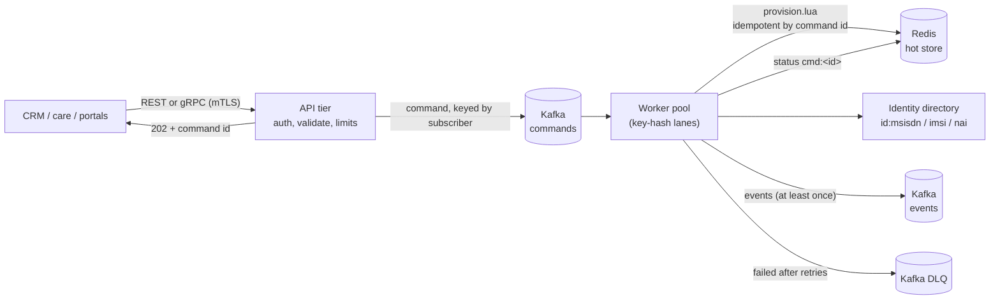

# Provisioning Service

`services/ocs-provisioning-service` is the control-plane write path: it creates
subscribers, tops up and adjusts balances, attaches bundles and moves
subscribers through the lifecycle. It never touches the charging hot path
directly; every change goes through the same atomic Redis scripts the rating
engine uses, so a provisioning change and a charging request can never
interleave inside one subscriber.

## Why asynchronous

A top-up during a Redis failover must not be lost and must not block the CRM.
The API tier validates and authorizes, writes the command to Kafka and answers
`202 Accepted` with a command id. Workers apply it when the data tier is
reachable, and callers poll `GET /v1/commands/{id}` (or consume the event).
Kafka keying by subscriber gives per-subscriber ordering; the worker pool hashes
the key to a lane so two commands for one subscriber are never applied
concurrently.

## Exactly-once effect from at-least-once delivery

- The caller's `Idempotency-Key` (REST header, gRPC field) is the command id.
  Re-submitting returns the original command; re-using the key with a different
  body is rejected (`409` / `ALREADY_EXISTS`) by comparing a fingerprint.
- `provision.lua` stores the outcome of every command id, failures included, so
  a redelivery returns the stored result and never applies twice.
- Offsets are committed only after the whole polled batch is applied, so a crash
  re-applies at most that batch, and the script de-duplicates it.
- Events are at least once. Consumers de-duplicate on `(commandId, type)`.
- Commands that keep failing for infrastructure reasons are retried with
  back-off; a poison command goes to the DLQ and the batch moves on.

## Operations

| Operation | REST | Privileged |
|---|---|---|
| create subscriber | `POST /v1/subscribers` | no |
| top up | `POST /v1/subscribers/{key}/top-ups` | no |
| attach bundle | `POST /v1/subscribers/{key}/bundles` | no |
| set / reload bucket | `PUT /v1/subscribers/{key}/buckets/{bucket}` | no |
| adjust balance (signed) | `POST /v1/subscribers/{key}/adjustments` | **yes** |
| remove bucket | `DELETE /v1/subscribers/{key}/buckets/{bucket}?force=true` | **yes** |
| change lifecycle | `POST /v1/subscribers/{key}/lifecycle` | **yes** |
| list requests waiting for approval | `GET /v1/approvals` | approver |
| approve / reject a request | `POST /v1/commands/{id}/approve`, `POST /v1/commands/{id}/reject` (`{"reason"}`) | approver |
| attach offering | `POST /v1/subscribers/{key}/offering` | no |
| command status | `GET /v1/commands/{id}` | no |
| read subscriber by key | `GET /v1/subscribers/{key}` | no |
| **find subscriber by MSISDN / IMSI / NAI** | `GET /v1/subscribers?msisdn=…` (or `imsi=`, `nai=`; exactly one) | no |
| form metadata (principal, currency, limits, offerings) | `GET /v1/meta` | no |
| web console | `GET /ui/` | no |

The same operations exist on the gRPC `ProvisioningService`
(`api/proto/ocs/v1/provisioning.proto`, generated code in `pkg/gen`).

Requests are strict: unknown JSON fields are rejected (a typo such as `amout`
must not become a silent zero top-up), amounts are positive integers in minor
units, and per-call ceilings apply (`OCS_PROV_MAX_TOPUP`,
`OCS_PROV_MAX_ADJUST`). Errors use `{"error":{"code","message"}}`.

### Create subscriber

Creating a subscriber binds its identifiers (MSISDN, IMSI, NAI) in the
directory (doc 06). A conflict (an identifier already owned by another
subscriber) fails the command with `identifier_conflict` and releases only the
bindings this command had just made, so a retry is clean.

### Finding a subscriber by identifier

`GET /v1/subscribers?msisdn=491701234567` (or `imsi=`, `nai=`; gRPC `FindSubscriber`)
resolves the identifier through the identity directory (doc 06) and returns the
same view as a read by key. An unknown identifier, or one bound to a subscriber
with no profile, is `404`; a malformed one or not exactly one parameter is `400`.
Values are normalised as everywhere else (an MSISDN is digits, a leading `+` is
accepted); the console strips spaces and punctuation before sending.

The view now lists the subscriber's **identifiers**. They are recorded on the
profile when the subscriber is created (the directory still decides what
resolves; the copy is for display). Subscribers created before this change show
none.

Because a lookup by phone number reads personal data, two rules apply:
- **Reading honours the allow-list.** If `OCS_PROV_CLIENTS` is set, a verified
  client that is neither listed nor privileged can no longer read either (before,
  any client with a certificate from the CA could). With no list, any verified
  client may read, as before.
- **Every lookup is logged** with the caller's identity, the identifier type,
  whether it matched, and the identifier **masked** to its last four characters.
  Reads by key are not logged yet.

### Web console

`/ui/` serves a single-page console (plain HTML, CSS and JavaScript embedded in
the binary; no build step, no third-party code) with two sections, and a **Manage**
card under every subscriber found:

- **Find subscriber**: search by MSISDN, IMSI or NAI; shows status, payment
  type, offering, identifiers and buckets with readable units.
- **Create subscriber**: MSISDN / IMSI / NAI, optional subscriber key (generated
  if empty), payment type, optional product offering (picked from the catalog
  version in effect) and an optional initial top-up. Creation is several
  asynchronous commands, so the page runs them in order (create, attach
  offering, top up), follows each to its outcome, shows the server's reason when
  one fails, and offers **Retry**. Each submission has one idempotency key base,
  so a retry never applies a step twice.

- **Manage** (shown only for actions the caller's certificate may perform;
  `GET /v1/meta` returns `can` and the limits, and the server still decides each
  request): *Top up* the cash balance; *Change the product offering* (with the
  option to renew existing allowances); *Correct a balance* (privileged: any
  bucket, signed amount, mandatory reason kept in the audit trail, bounded by the
  adjustment limit); *Change status* (privileged: only the valid next states are
  offered; grace takes an optional deadline; **termination is final and needs the
  subscriber key typed in**). A terminated subscriber shows no actions. Each action
  sends one command and follows it to its outcome. Its idempotency key is kept only
  while the outcome is unknown (timeout, network error, 5xx), so pressing the button
  again cannot apply it twice, and is dropped after a definite answer or an edit of
  the form (a new decision is a new request). The card refreshes from the hot store
  after each change and says what happened.

How it is secured: it is served by the same listener as the API, so it sits
behind the same mTLS client-certificate authentication and the same
authorisation: it can do exactly what its user's certificate may do through the
API. There is no login page and no session: the browser presents the client
certificate. Specific defences:
- A strict Content-Security-Policy (`default-src 'none'; script-src 'self'; ...`,
  no `unsafe-*`), `X-Frame-Options: DENY`, `nosniff`, `Referrer-Policy:
  no-referrer`. The page has no inline script.
- All data from the API is written with `textContent`, never as HTML (verified
  in a real browser with a key containing markup, and by a deliberate
  `innerHTML` regression that the check catches).
- **Cross-site request forgery.** Browsers attach client certificates to any
  request, so state-changing requests carrying an `Origin` header for another
  host are refused (`403 cross_origin`). The JSON content type and the custom
  `Idempotency-Key` header already force a CORS pre-flight that is never granted.

The console is checked in a real Chromium with Playwright:
`internal/ui/browser-check/console.mjs` (run by hand, not in CI, against
`OCS_UI_DEV_ADDR=127.0.0.1:8443 go test -run ServeConsoleForManualTesting
-timeout 1h ./services/ocs-provisioning-service`, which serves the console on an
in-memory stack with authentication off). It checks validation, a full create
with offering and top-up, every Manage action (bad input refused in the page with
nothing sent, top-up, correction needing a reason, offering change, suspend, the
wrong key refused for termination, termination leaving no actions), find by MSISDN (typed with `+` and a space) and by
IMSI, not-found, a duplicate MSISDN refused with the reason, markup shown as
text, no console errors or CSP violations, and no horizontal scrolling at phone
width. Light, dark and phone layouts were looked at.

### Offerings (price plan and allowances)

`attach_offering` (`{"offering": "gold-offer", "renew": false}`) puts the
subscriber on a catalog product offering (doc 09). Two things happen in **one
atomic script** (`provision.lua`, op `P`): the offering id is stored on the
subscriber's profile, and the offering's allowance buckets are created. Either
all of it applies or none: if any allowance bucket already exists (or exists
with another class) nothing is written and the command fails with
`allowance_exists`. `renew: true` resets existing allowance buckets to their
full amount and expiry instead (a monthly renewal) and also switches the
offering.

The API tier resolves the offering from the catalog version in effect **when the
command is accepted** and puts the resulting allowances (amount, class, unit,
order, absolute expiry = acceptance time + validity days) into the command, so
what is queued is exactly what will be applied, and a redelivery after a catalog
change applies the same thing. The idempotency fingerprint covers only what the
caller asked for (subscriber, offering, renew), so a retry after a catalog change
is the same request, not a conflict. With no catalog in effect the API answers a
retryable `503 catalog_unavailable` (gRPC `UNAVAILABLE`); an offering that is not
in the catalog is `400`.

Bucket ids are the allowance ids of the catalog, so two offerings that use the
same allowance id share a bucket (renewal resets it). Keep ids unique per
purpose. The offering decides the price plan used to rate the subscriber
(doc 09), seen by gateways within `OCS_PLAN_CACHE_TTL` (30 s).

### Lifecycle

`Active -> Grace -> Suspended -> Terminated`, with recoveries back to Active
(doc 03). The change is atomic with the charging scripts: once a subscriber is
Suspended or Terminated, `charge.lua` answers `BARRED` for new quota while still
settling usage from sessions already open.

#### The end of a grace period

A change to Grace may carry a deadline (`graceUntil`). With `OCS_PROV_GRACE_SWEEP` set, the service
suspends the subscriber itself when the deadline passes; without it nothing does (the default is `off`,
which is the behaviour before this existed: an operator or upstream system issues the command).

- **Index.** The lifecycle script keeps a sorted set `ocs:grace:due` (member: the subscriber's key
  prefix, score: the deadline) in step with the profile, in the same atomic call: entering Grace with a
  deadline adds it, any other change removes it. Grace without a deadline never expires.
- **Sweeper.** In every instance that runs the command worker (`all` or `worker`), every
  `OCS_PROV_GRACE_SWEEP` (1s to 1h) it reads up to 200 overdue entries per round and applies an *expire grace*
  step for each. The step suspends only if the subscriber is **still in the very grace period that was seen**:
  a subscriber restored to Active, or given a longer grace, meanwhile is left alone (the step answers
  `invalid_transition` or `grace_changed`, and the index entry is repaired or dropped). A step that finds the
  deadline not yet reached answers `grace_not_over` and changes nothing. Refusals are not remembered under the
  step's token, so a later attempt sees the state then.
- **Several instances, crashes.** The step's token is derived from the subscriber and the deadline, so
  concurrent sweepers, or a sweeper that restarts, suspend a subscriber once (the second gets the stored
  original answer).
- **Event.** `lifecycle.changed` (`from: grace`, `to: suspended`, `by: system:grace-expiry`, `reason: grace
  period ended`, `operation: expire_grace`) is published after the step and the index entry is removed only
  after the publish succeeded. If Kafka is down the subscriber is already suspended, the entry stays, the
  event is published on a later pass (at least once, like every event here) and the backlog is visible as
  `ocs_prov_grace_overdue`.
- **Not approval-gated.** A suspension the system makes because a deadline passed is not a person's privileged
  request, so it does not go through two-person approval; the deadline itself was set by a privileged
  caller (and approval applies to that if `change_lifecycle` is in the policy).
- **Metrics.** `ocs_prov_grace_expired_total`, `ocs_prov_grace_stale_total`, `ocs_prov_grace_sweep_errors_total`,
  and the gauges `ocs_prov_grace_overdue` and `ocs_prov_grace_oldest_overdue_seconds` (after the last sweep;
  they keep rising if Redis or Kafka stay broken). No alert rule uses them yet.

## Two-person approval

A privileged caller can move or destroy value: correct a balance, remove a bucket, suspend or terminate a
subscriber. With approval on, such a command is **not queued when it is submitted**. It waits as a request
until a *different* authorised person approves exactly what was requested; one person alone can never make
it happen. Routine flows (create, top-up, bundles, offering changes) are never held back.

**Policy** (`OCS_PROV_APPROVAL`, required: `off` is a choice that has to be made): `off`, or a comma
separated list of rules.

| Rule | Holds back |
|---|---|
| `adjust_balance` | every balance correction |
| `adjust_balance>5000` | corrections larger than 5000 (absolute; minor units or units) |
| `change_lifecycle` | every status change |
| `change_lifecycle:terminated\|suspended` | only these target states |
| `remove_bucket` | every bucket removal |

Parsing is strict: an unknown type or state, a bad threshold, an empty or duplicated rule is an error, so a
typo cannot silently leave a command unprotected.

**Flow.** The privileged endpoints answer `202` with `"state":"pending_approval"`, the rule and the expiry
instead of `accepted`; nothing is queued and nothing changes. The request is stored whole in Redis. An
approver (`GET /v1/approvals` lists what waits, with a plain-words summary) calls
`POST /v1/commands/{id}/approve`; the service records the approval, queues the stored command **with the
approval attached**, and the worker applies it. The approver supplies nothing but their identity, so what is
applied is exactly what was requested. `POST .../reject` ends a request for good (the requester may
withdraw their own). A request that nobody decides in `OCS_PROV_APPROVAL_TTL` (default 24 h) is reported as
`expired` and can no longer be approved. States: `pending_approval` -> `accepted` -> `applied`/`failed`, or
`rejected`, or `expired`. `GET /v1/commands/{id}` shows the rule, who asked, and who approved or rejected.

**Who.** Approvers are the privileged callers plus `OCS_PROV_APPROVERS` (certificate names that may approve,
reject and read, but not make privileged requests). The approver must differ from the requester: that is
decided inside one atomic Redis script together with the state and the expiry, so two approvers racing for
one request cannot both win, and a self-approval is refused (`403 self_approval`) whatever the API caller
does. With mutual TLS the service refuses to start unless at least two different callers can approve, and
refuses `OCS_PROV_APPROVAL_SELF=true`. With authentication **off** everyone is `anonymous`, so a policy is
refused unless `OCS_PROV_APPROVAL_SELF=true` explicitly allows a requester to approve their own request:
for trying the flow in development only.

**Defence in depth.** The worker enforces the same policy: a command the policy holds back is applied only if
it carries an approval by someone other than its requester (`approval_required` / `self_approval` otherwise,
recorded as a final failure). It cannot stop a writer who can forge the approval field on the Kafka topic,
but it stops an API bug or a message that skipped the approval step. Consequently the policy must be the same
on the API and worker pods (the chart guarantees it), and turning a policy on makes privileged commands that
were already queued unapproved fail.

**Audit trail.** Events on the events topic: `approval.requested` (who, rule, what), `approval.approved`
(approver), `approval.rejected` (who, why); the resulting `balance.modified` / `lifecycle.changed` event carries
`approvedBy` next to `by`. The decision itself is recorded in the status store before the event is published;
a failure to publish an approval event is counted (`ocs_prov_approval_event_errors_total`) and logged, and does
not undo the decision.

**Recovery.** If queuing an approved command fails, the request goes back to pending and the approval can be
repeated. If the process dies after recording the approval but before queuing it, the same approver repeating
it (after the republish delay) queues it again; applying is idempotent. A requester repeating their own request
never queues their copy once it is approved.

**Console.** Approvers get an *Approvals* tab (with a count) listing what waits, in words, with Approve and
Reject (a reason) buttons; the requester's own requests show *Withdraw* only, with the reason approval is
disabled. After a privileged action that is held back, the subscriber card says so ("Submitted for approval,
not applied yet") and shows the rule; nothing changes on the card until it is approved.

**Metrics and alerts.** `ocs_prov_approvals_total{result}` (requested, approved, declined, refused_self,
refused_expired, refused_not_pending), `ocs_prov_approvals_pending` and `ocs_prov_approvals_oldest_age_seconds`
(read from Redis every 30 s), `ocs_prov_approval_event_errors_total`; alerts for a request waiting too long,
an attempted self-approval and an unpublished trail (doc 12).

## Authorization

Authentication is mTLS; the caller identity is the client certificate CN
(`OCS_PROV_CLIENTS` lists standard callers, `OCS_PROV_PRIVILEGED` the callers
allowed the privileged operations). An empty standard list admits any verified
client for standard operations. `OCS_PROVISIONING_AUTH` must be set explicitly to
`mtls` or `off`; the service refuses to start otherwise, so a missing variable
can never silently open the API. `off` is for local development only.
Unauthenticated callers get `401`/`UNAUTHENTICATED`, authenticated callers
without the right get `403`/`PERMISSION_DENIED`.

## Events

Topic `OCS_KAFKA_EVENTS_TOPIC`, key = subscriber, JSON, `v: 1`:

| type | when | extra fields |
|---|---|---|
| `subscriber.provisioned` | create applied | `payment`, `version` |
| `balance.modified` | top-up, adjustment, bundle, bucket set/remove | `bucket`, `delta`, `balance`, `reason` |
| `lifecycle.changed` | lifecycle change applied, or a grace period ended (`by: system:grace-expiry`) | `from`, `to`, `reason` |
| `offering.changed` | offering attached or renewed | `from`, `to` (offering ids; `from` empty if none), `buckets` |
| `command.failed` | business failure (e.g. insufficient balance, conflict, `approval_required`) | `outcome`, `message` |
| `approval.requested` | a privileged command was held for approval | `by`, `rule`, `reason` (what will happen, in words) |
| `approval.approved` | a second person approved it | `by`, `approvedBy` |
| `approval.rejected` | it was declined or withdrawn | `by`, `rejectedBy`, `reason` |

Events of commands that needed approval also carry `approvedBy`.

## Configuration

| Variable | Meaning | Default |
|---|---|---|
| `OCS_PROV_MODE` | `all`, `api` or `worker` | `all` |
| `OCS_KAFKA_BROKERS` | brokers | required |
| `OCS_CURRENCY` | currency of monetary buckets | required |
| `OCS_PROVISIONING_AUTH` | `mtls` or `off` | required |
| `OCS_PROV_TLS_CERT` / `_KEY` / `OCS_PROV_CLIENT_CA` | server cert and client CA | required for `mtls` |
| `OCS_PROV_CLIENTS`, `OCS_PROV_PRIVILEGED` | allowed CNs | any / none |
| `OCS_PROV_APPROVAL` | `off`, or the rules that need a second person (see above) | **required** |
| `OCS_PROV_APPROVERS` | CNs that may approve and reject without being privileged | none |
| `OCS_PROV_APPROVAL_TTL` | how long a request waits (1m to 720h) | 24h |
| `OCS_PROV_APPROVAL_SELF` | `true` lets a requester approve their own request; development with auth off only | false |
| `OCS_PROV_GRACE_SWEEP` | `off`, or how often to suspend subscribers whose grace period has ended (1s to 1h) | `off` |
| `OCS_PROV_REST_ADDR`, `OCS_PROV_GRPC_ADDR` | listeners | `:8443`, `:9443` |
| `OCS_PROV_WORKERS` | key-hash lanes | 16 |
| `OCS_PROV_MAX_TOPUP`, `OCS_PROV_MAX_ADJUST` | per-call ceilings | 10,000,000 / 1,000,000 |
| `OCS_KAFKA_COMMANDS_TOPIC`, `_EVENTS_TOPIC`, `_DLQ_TOPIC`, `_GROUP` | topics and consumer group | built-in names |
| `OCS_REDIS_ADDR` (catalog) | the catalog is read from the same Redis; the service follows new versions on its own and starts without one | |
| `OCS_IDENTITY_PREFIX` | identity directory key prefix; must match the gateway | `id:` |

Durability env (replica `WAIT`) is shared with the gateway through
`pkg/svcenv`.

## Verification

- Unit tests per package: command validation and fingerprinting, status store,
  authorizer, REST (strict decoding, status codes, mutation-checked), gRPC
  (status mapping, principal from peer cert), service, worker apply/events.
- `e2e_test.go`: REST and gRPC over real mTLS -> in-process Kafka (kfake) ->
  workers -> real `redis-server`, then the charging path: a suspended subscriber
  gets `ItemBarred`.
- Two-person approval: the policy parser (strict, table-driven), the status store against a real
  `redis-server` (one winner among 16 concurrent approvers, expiry to the millisecond, self-approval,
  rollback of a failed approval, index consistency), the service (not queued until approved, exactly the
  requested command queued with the approval attached, repeating a request never queues the unapproved copy,
  recovery after a failed or lost queue), the worker's second enforcement, configuration refusals, REST and gRPC
  (who may list, approve and reject; status codes), and an end-to-end test through mutual TLS with four
  identities, Kafka, workers and Redis. Mutation-checked: allowing self-approval, queueing a held command, not
  attaching the approval, skipping the worker's check, republishing the requester's copy and dropping the
  approve authorisation each make a test fail. In a real browser (`console.mjs`): a large correction and a
  termination are held, listed in words, one withdrawn, one approved and applied. Through the real Docker stack
  (`dev/smoke.sh`): held, balance unchanged, approved, applied, and `approval.requested` ->
  `approval.approved` -> `balance.modified` (with `approvedBy`) in the Kafka events topic.
- Grace expiry: against a real `redis-server`, the index follows every route out of Grace; the expire step
  refuses before the deadline, for a subscriber restored to Active, for a longer grace, and for an unknown
  subscriber, and is idempotent; the sweeper handles more than one batch, retries a failed publish without
  suspending twice, keeps the overdue gauge honest while Kafka is down, and two concurrent sweepers suspend
  each subscriber once. Mutation-checked: ignoring the deadline comparison, the status check or the "not over
  yet" check in the script, and not removing the index entry when leaving Grace, each make a test fail. An
  end-to-end test (mTLS, Kafka, workers, Redis): a subscriber put into Grace for 3 s is `suspended` within
  seconds and charging answers `ItemBarred`, while one restored in time stays Active. Not run against the
  Docker stack's smoke test or a cluster, and the Helm value was added without rendering the chart (no `helm`
  in the sandbox).
- Smoke of the real binary against a standalone broker and Redis, driven by
  `curl`/`openssl`: config refusals, create -> applied, top-up -> balance 2500,
  standard caller denied a privileged op (403), no client certificate refused,
  directory and balance visible in Redis.
- Test pins: franz-go v1.18.1 with the matching kfake pseudo-version (newer
  releases raise the module's Go version).

## Known gaps

- Kafka connections are plaintext: no TLS or SASL to the brokers yet.
- The fail-policy profile cache is not yet fed from provisioning events, so the
  postpaid fail-open path has no live profile source (doc 02, point 1).
- The Grace -> Suspended timer only covers grace periods that were given a deadline **after this version
  is deployed**: subscribers already in Grace are not in the index and need one more lifecycle command (to
  Grace with a deadline) to be tracked. The index is a single Redis key (another reason for no Redis
  Cluster support), it is node-time based (the sweeper's clock decides what is overdue, within the clock
  skew between provisioning nodes), the timer has no alert rule yet, and there is no automatic return to
  Active on payment (a top-up does not change the lifecycle state; upstream still sends the command).
- No reconciler for usage left unsettled when a session is barred mid-flight.
- The command status store is advisory (TTL-bound); the idempotency record in
  the hot store is the source of truth.
- Events are at least once, not exactly once.
- Offering changes reach gateways after their profile cache expires (no push invalidation), and a subscriber cannot be moved to another offering without also creating that offering's allowances (no 'switch plan only' command).
- The console has no login of its own (it relies on browser client certificates; a production deployment
  would normally put SSO/OIDC in front). It covers find, create, top-up, offering change, balance
  correction and lifecycle change and, for approvers, the Approvals tab, but not bundles or
  removing/reloading single buckets, no list or search by name, no bulk actions, and no
  transaction or usage history.
- Approval: one approver is enough (no "two of three"); a request is approved or not as a whole (an approver
  cannot amend it); requests that never needed approval (routine flows) have no second check; the pending
  gauges are read every 30 s; an approver is identified by certificate name only, so two people sharing a
  certificate are one person; there is no notification to approvers (poll the console, or consume the
  `approval.requested` events); and the same policy is not available for catalog publishes yet.
- Lookup by identifier shows balances and identifiers but not sessions, usage or ledger entries.
- Reads by key are not logged (lookups by identifier are).
