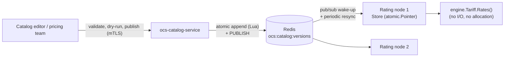

# Tariff Catalog

Code: `pkg/catalog` (model, compiler, store, replication, tariff adapter, dry-run),
`pkg/catalog/expr` (condition language), `services/ocs-catalog-service` (REST
management API), and the gateway's `OCS_TARIFF=catalog` mode.



## Model

| Type | Role |
|---|---|
| `Document` | One editable catalog version: `effectiveFrom`, plans, offerings. JSON in, JSON out. |
| `PricePlan` | Time zone, policy `filters`, and ordered `rules`. |
| `ChargeRule` | `when` condition, `priority`, which bucket `classes` may pay, and the cash `price` (`num/den` minor units per unit). |
| `PolicyFilter` | A `deny` condition checked before any rule (for example roaming on a domestic plan). |
| `ProductOffering` | A plan plus `allowances` (bundle/promo buckets with unit, amount, validity, order). |

Pricing semantics are exactly those of the charge script (doc 03): promo and
bundle buckets debit 1:1, cash at `num/den`, consumed in bucket-order. A rule
chooses *which classes may pay* and *the cash price*; it cannot invent a new
bucket class.

## Conditions (`pkg/catalog/expr`)

```
rat in ["NR","LTE"] && (hour >= 22 || hour < 6) && !startsWith(cell, "262-01")
```

Variables: `rat slice cell unit rg service hour minute weekday` (time values are
in the plan's time zone). Operators `|| && ! == != < <= > >= in`, functions
`startsWith endsWith contains`, string/number/bool/list literals. No loops,
assignment, user functions or regular expressions, so cost is bounded.
Expressions are parsed and **type-checked at publish time** (`rat == 5`,
`hour in ["a"]`, unknown variables are rejected) and compiled to closures.
Measured here: ~40 ns per evaluation, 0 allocations; `Snapshot.Rates` end to
end ~130 ns, 0 allocations (asserted by tests). Limits: 2000 bytes, nesting 32,
256 list items, fuzzed (`FuzzCompile`) with no panic found in the short run.

This is a custom language instead of `antonmedv/expr`: the surface is small
enough to specify and fuzz completely, there is no reflection, and the
variable set cannot be widened by accident.

## Versions and time travel

- A `Store` holds an immutable timeline of compiled snapshots behind an
  `atomic.Pointer`. `At(t)` is one atomic load and a binary search; publishing
  builds a new timeline and swaps it. Readers never lock or wait.
- History is **append-only**: version = previous + 1, and `effectiveFrom` must
  be later than the latest version's. A version dated in the future sits in the
  timeline and starts pricing at that instant, with no restart, flush or timer.
- Past versions stay readable (`GET /v1/catalog?at=...`, `Tariff.RatesAt`) for
  re-rating offline usage. The newest `OCS_CATALOG_RETAIN` (default 64) are
  kept; trimming never drops the version in effect or anything newer.
- Live pricing uses the **processing time**, not the network-reported event
  time (which a misbehaving peer could skew).

## Publishing

`validate` -> `dry-run` -> `publish`, all against the same compiler.

- **Validate** returns *every* problem with a JSON path
  (`plans[0].rules[2].when`), plus warnings (unreachable rule, no catch-all).
- **Dry-run** prices synthetic cases under the version in force at each case's
  time and under the draft, and reports what changed. Nothing is published.
- **Publish** needs a publisher certificate. An atomic Lua script appends only
  if the list length equals the previous version, so two editors cannot publish
  the same version (tested: 8 concurrent publishers, exactly the stored ones
  succeed). A stale `expectedVersion` is `409`, an invalid document `422`.

## Distribution

Redis is the system of record (list element *i* = version *i+1*). Nodes
subscribe to a channel only as a wake-up and also resync every
`OCS_CATALOG_RESYNC` (30 s), so a lost message delays an update but never loses
one. A node that fails to sync, or finds an unreadable stored version, keeps
serving the last good catalog and reports the error. A late-joining node loads
only the newest `retain` versions.

## Engine integration

`catalog.Tariff` implements `engine.Tariff`. When a unit cannot be priced
(barred by a filter, no matching rule, unknown plan) it returns `engine.ErrNoTariff`
and the engine now sends **that unit with no rates** instead of failing the
whole request: no new quota can be reserved for it, but usage already
reserved is still settled, a terminate still succeeds, and any excess usage is
reported as a shortfall. This closes a hole where a plan change mid-session
could have dropped a settlement. Counted in `engine.Stats.Unpriced`.

Gateway: `OCS_TARIFF=catalog` with `OCS_DEFAULT_PLAN`. It refuses to start
unless a version is in effect and the plan exists.

## Per-subscriber plans

A subscriber's profile carries an offering id (set by the provisioning service,
doc 08). `catalog.ProfileResolver` turns it into a plan:

```
subscriber --(profile HGET, cached 30 s)--> offering id --(catalog version in effect)--> plan id
```

- The offering is cached per subscriber (sharded, bounded at 1,000,000 entries,
  `OCS_PLAN_CACHE_TTL`). The offering -> plan step is not cached: it is a map
  lookup in the snapshot, so a catalog publish that re-points an offering at
  another plan applies at once.
- A subscriber with no profile or no offering is priced on `OCS_DEFAULT_PLAN`.
- A **failed lookup is never answered with the default plan** (that would price
  someone on the wrong tariff because Redis blinked): the unit gets no rates
  (no new quota, usage already reserved still settles) and the engine counts it
  as unpriced. An offering missing from the catalog is handled the same way.
- Cost: one extra Redis `HMGET` on a cache miss, with a 100 ms bound; hits are a
  sharded map read. Not yet measured under load.
- The mediation pipeline uses the same resolver with the subscriber's *current*
  offering (the offering at record time is not recorded).

## API

See `services/ocs-catalog-service/internal/api`. Reads, validate and dry-run
need any verified client certificate; publish needs a common name in
`OCS_CATALOG_PUBLISHERS`. `OCS_CATALOG_AUTH` must be `mtls` or `off` explicitly.
`GET /v1/catalog/schema` returns the variables, functions, enums and limits so an
editor can build its form without hard-coding them.

## Verification

Unit and integration tests with a real `redis-server`; mutation-checked:
disabling the engine tolerance, the policy filters, the atomic append guard,
the publisher check, strict JSON decoding and the conflict mapping each makes a
test fail. End to end: REST over mTLS -> Redis -> an independent node that
prices from the replicated catalog, including a future-dated version.

## Known gaps

1. **Offering changes are seen after the cache TTL** (30 s by default) by gateways
   and mediation nodes; there is no push invalidation. There is no command to
   move a subscriber to another plan without also creating its allowances.
2. **Offering ids must outlive their subscribers.** A subscriber whose offering is
   missing from the catalog version in effect is not priced (no new quota)
   rather than silently moved to the default plan.
3. **Rule inputs are request attributes only.** There is no subscriber
   location, tier or accumulated-usage variable, so tiered or volume-discount
   pricing across a billing period is not expressible.
4. **Price granularity.** A cash price is `num/den` with `den <= 4096` (limit of
   the charge script's exact arithmetic), so a price per megabyte
   (`n/1048576` per byte) is not representable; pick a coarser unit or extend
   the script.
5. **REST only**, no gRPC; no per-publish author in the version record (the
   mTLS identity is not stored with the version).
6. **Redis durability** applies to the catalog list as to everything else
   (doc 07); publish does not `WAIT` for a replica.
7. **Rated time** is processing time; offline re-rating must pass the CDR time
   explicitly through `RatesAt`.
