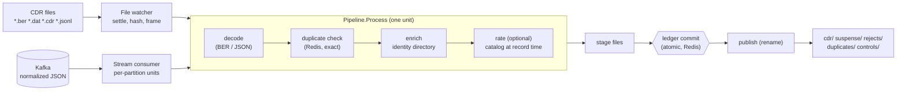

# Offline CDR Mediation Pipeline

Code: `services/ocs-mediation-pipeline` (`internal/ber`, `cdr`, `dedup`, `ledger`,
`sink`, `pipeline`, `source`).

Mediation takes the records the network produced (PGW/SMF CDR files, a stream
of normalized records) and produces clean records for billing, reconciliation
and analytics: decoded, de-duplicated, matched to our subscriber, optionally
priced, with control totals that prove nothing was lost.



## Inputs

| Source | Format | Unit of atomic commit |
|---|---|---|
| Directory (`OCS_MED_IN_DIR`) | BER back-to-back records (`.ber .dat .cdr`) or JSON lines (`.jsonl .json`) | the whole file |
| Kafka (`OCS_KAFKA_BROKERS`, topic `ocs.mediation.cdr`) | one normalized JSON record per message | one partition's slice of a poll |

Scale out by running more instances: Kafka partitions are shared by the consumer
group, and several instances may watch the same directory (the ledger lets
exactly one commit a given file).

### Files

A file is read only after it has been unchanged for `OCS_MED_SETTLE` (default
5 s). Its content hash and name identify it, so a re-sent file with the same
name and bytes is recognised as done, and the same bytes under another name are
caught as duplicate *records*. Layout beside the input: `processed/`, and
`quarantine/` with a `<name>.error` for every file that cannot be framed
(truncated or malformed BER, oversize, too many records). **A file with a framing
error is quarantined whole**: BER cannot resynchronise after a bad length, so
processing "the good part" could silently drop or invent records.

### BER decoding (`internal/ber`, `internal/cdr/ber.go`)

A streaming TLV reader: definite and indefinite lengths, high tag numbers,
nesting. It is written for hostile input: lengths are checked against
remaining bytes and a 4 MiB element cap before allocation, nesting is capped at
16, malformed input is an error (fuzzed, plus 20,000 random inputs in a test).
~4.5 µs and 35 allocations per record on the sandbox (records decoded from a
reused reader).

The field mapping for PGW-CDR (`cdr.PGWMapping`) is **table driven and not
verified against real files.** The tag numbers were written from the 3GPP
TS 32.298 PGWRecord definition as recalled, and the tests round-trip against an
encoder written from the same table, so they prove the decoder logic, not the
tag assignments. Vendors also differ (file headers, optional fields, timestamp
digit order). Before production: run a real file from each network element,
compare against the vendor's own decoder, and override with `OCS_CDR_MAPPING`
(a JSON `Mapping`) where they differ. SMF-CDR needs its own mapping; none is
supplied.

## Exactly-once effect

Input is at-least-once (Kafka redelivery, re-sent files, restarts). Output is
made exactly-once like this:

1. **Dedup key** = hash of record type, node, charging id, record sequence,
   opening time and subscriber identifiers (not volumes or source, which can
   differ between copies). Redis stores `key -> source position` for
   `OCS_MED_DEDUP_WINDOW` (72 h). A key seen again from a **different** position
   is a duplicate; from the **same** position it is a replay and is processed
   normally. That is what lets a crashed unit be retried to the same output.
2. **Stage, commit, publish.** A unit's output is written to `.staging/<unit>/`
   and synced; then **one atomic Redis step** (`ledger.Commit`) records the unit
   as done; then the files are renamed into place. Names are deterministic from
   the input, so publishing twice is harmless.
   - Offsets units commit only if they lie wholly above the partition's
     watermark. A unit that overlaps committed work (another consumer got there
     after a rebalance) is **discarded, not trimmed**, because the other unit's
     output file already holds the overlapping records.
   - File units commit with `SETNX` on name + content hash.
3. **Crash repair** (`Sink.Recover`, run at start-up): a staged unit whose
   commit was recorded is published; any other staged unit is deleted.
4. **Kafka offsets are only a bookmark.** The ledger watermark is the truth;
   losing or rewinding group offsets re-reads records that are then skipped.
   Tested: start with a fresh consumer group over the full topic and the
   output files and record counts are unchanged.
5. Ledger commits wait for a replica (`WAIT`, same rule as doc 07); a shortfall
   is counted (`Ledger.Unreplicated`) and logged.

A Bloom filter in front of the dedup store was considered (rolling window) and
left out: an exact Redis check is required anyway to record the key for the
other nodes, so a filter does not save the round trip it was meant to save.

## Enrichment and rating

- **Enrichment** resolves IMSI/MSISDN to the internal subscriber key through the
  identity directory (doc 06; cached). An unknown subscriber, a conflict
  (IMSI and MSISDN belong to different subscribers) or an invalid identifier
  sends the record to **suspense** (`suspense/dt=…/`), never to the bin. A
  directory outage fails the unit, which is retried: it must not be mistaken for
  "unknown subscriber".
- **Rating** (`OCS_MED_RATING=catalog`, `OCS_DEFAULT_PLAN`) adds a list-price
  `charge` per container and per record, priced with the cash rate of the
  **catalog version in effect when the record opened** (`Tariff.RatesAt`) and the subscriber's plan (per-subscriber offering, doc 09), so a
  late file after a price change still uses the price that applied; the version
  is recorded on the record. Allowances and bundles are *not* applied (online
  charging already debited them): this is a reconciliation/post-paid value, not
  the amount taken from a balance. Containers that cannot be priced (barred,
  no rule, no cash rate) carry the reason and count as `unrated`.

## Output (`OCS_MED_OUT_DIR`)

```
cdr/dt=YYYY-MM-DD/<unit>.jsonl         good records (enriched, rated)
suspense/dt=YYYY-MM-DD/<unit>.jsonl    valid records for unknown/conflicting subscribers
rejects/<unit>.jsonl                   undecodable/invalid records: reason + first 4 KiB, base64
duplicates/<unit>.jsonl                records recognised as duplicates (identity only)
controls/<unit>.json                   audit totals
```

`controls` has input/output/suspense/rejected/duplicate/unrated counts, uplink,
downlink, duration and charge sums over the good records, first/last opening
time, and `balanced` = `in == output + suspense + rejected + duplicates`. A test
writes 300 mixed records and checks every one lands in exactly one output file
and that the controls match the files.

JSON lines on a directory is the only sink. ClickHouse, Iceberg/Parquet and S3
writers (the brief's store-and-forward targets) are not built; the `sink`
package is the seam, and a mounted object-store volume works today.

## Configuration

See `services/ocs-mediation-pipeline/config.go` for the full list. Requires
`OCS_MED_OUT_DIR` and at least one of `OCS_MED_IN_DIR`, `OCS_KAFKA_BROKERS`;
refuses to start if fewer Redis replicas are connected than `OCS_REDIS_REPLICAS`
(default 1) unless `OCS_ALLOW_NO_REPLICA=true`.

## Measured (sandbox, loopback Redis, not a benchmark environment)

`Pipeline.Process` over units of 1,000 JSON records with a map enricher:
~40,000 records/s per unit (dominated by the duplicate-check round trip and
JSON encoding). BER decode alone ~4.5 µs/record. Units are processed one at a
time per source loop, so throughput scales with partitions/instances, not
within a unit. Nothing here has been run against production file sizes.

## Verification

Unit and integration tests with a real `redis-server` and an in-memory Kafka
(kfake). Mutation-checked: dedup that treats replays as duplicates, a ledger
that allows overlapping units, a directory outage mapped to suspense, skipping
publish, and tolerating BER framing errors each make a test fail. End to end:
BER file -> output and controls; the same file re-sent under another name ->
all duplicates; the same name and bytes -> recognised as done; a truncated file
-> quarantined with nothing committed; Kafka over two partitions with an
invalid record and a copy of a file record; restart with a fresh group.

## Known gaps

1. **Unverified BER tag mapping** (above); no SMF-CDR mapping; no handling of
   vendor file headers/trailers; BER Release-specific extensions are ignored.
2. **No SFTP/FTP pull.** Files must arrive in a directory (an SFTP server, a
   sidecar, or a mounted volume). Adding `github.com/pkg/sftp` was left out as a
   heavy dependency until the target transport is chosen.
3. **Directory sink only**; no ClickHouse/Iceberg/S3/Parquet writer.
4. **Whole file in memory** (cap 256 MiB / 1,000,000 records, then quarantine);
   very large files need a streaming unit design.
5. **Late records beyond the dedup window** (72 h) are not recognised as
   duplicates. The window is configurable; the cost is Redis memory.
6. **Unmatched records are held in suspense but nothing re-drives them** when the
   subscriber is later provisioned.
7. **Offline rating is list price on cash only**, bytes only, on the plan of the
   subscriber's *current* offering (the offering in force when the record was
   opened is not recorded; doc 09).
8. **No Kafka TLS/SASL** in this service (same as provisioning).
9. **The duplicate window and ledger are in Redis**: their durability is the
   durability of that Redis (doc 07). Losing the dedup window can let a
   re-sent record through as new until it is caught downstream.
