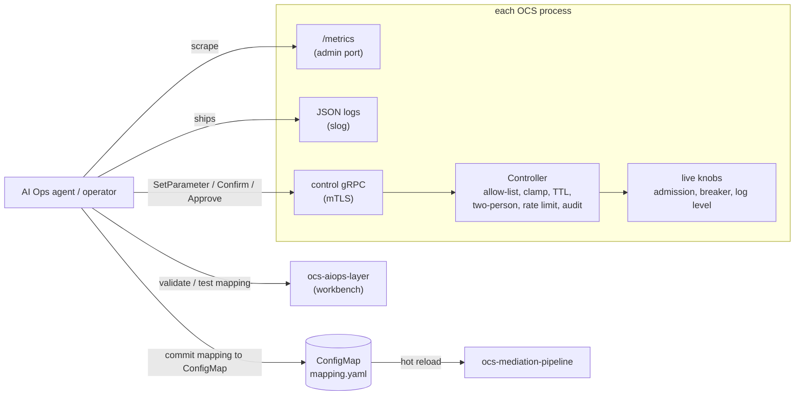

# AI Ops Integration: Telemetry, Guarded Control, Declarative Mappings

Code: `pkg/telemetry`, `pkg/control` (+ `controlrpc`), `pkg/mapping`, wiring in
`services/ocs-signaling-gateway` and `services/ocs-mediation-pipeline`,
`services/ocs-aiops-layer` (mapping workbench), `api/proto/ocs/v1/aiops.proto`.

This module does **not** contain an AI agent or anomaly detection. It is the
surface an agent (or a human operator) needs to *observe* the system, *tune* it
within hard limits, and *teach it new record layouts* without a code change.
The guiding assumption: the caller can be wrong, compromised or
prompt-injected, so every limit lives on the server side.



## 1. Telemetry (`pkg/telemetry`)

- **Metrics** in the Prometheus text format on the admin port (`/metrics`,
  `OCS_ADMIN_ADDR`, default `:8080`). Counters and gauges are read at scrape
  time from the atomics the components already keep, so nothing is copied on the
  request path. The admin port is unauthenticated: keep it cluster-internal.
- **Latency histogram** `ocs_engine_rate_duration_seconds` around every
  `engine.Rate` call (queueing plus processing), buckets chosen for a 10 ms P99
  target (0.1 ms ... 1 s). `Observe` is lock-free and allocation-free (172 ns
  per call with 4 goroutines hammering one histogram, which is atomic
  contention; sharding the buckets would reduce it if it ever shows in a
  profile). `Quantile` interpolates inside a bucket the way
  `histogram_quantile` does.
- **Gateway metrics**: engine requests / degraded / overloaded / unpriced /
  unreplicated / audit-dropped, admission in-flight and rejected, identity
  resolutions / unknown / conflicts / errors, durability waits / short /
  errors / suspended, data-tier breaker open / forced, Go goroutines, heap, GC
  pause total and cycles.
- **Mediation metrics**: units committed and stale, records by outcome
  (received, output, suspense, rejected, duplicate, unrated), ledger commits not
  confirmed by a replica, mapping reloads and rejections.
- **Logs**: JSON via `log/slog`, stamped with the service name; the standard
  `log` package is routed through it so existing lines become JSON too. The
  level is `OCS_LOG_LEVEL` and can be changed at run time through the control
  plane. Callers must not log secrets; nothing redacts.

Not done: OpenTelemetry SDK / OTLP export, distributed traces (Jaeger/Tempo),
`uber-go/zap`. A Collector can scrape `/metrics` and forward OTLP; there are no
traces at all yet. Provisioning, the catalog service and catalog replication export
metrics too (see [12](12-deployment.md#observability)), with alert rules and a
dashboard in the Helm chart; Kafka consumer lag and gRPC calls are not exported.

## 2. Guarded control plane (`pkg/control`)

A process registers the parameters an agent may touch, each with a type and
limits. The Controller enforces:

| Rule | Behaviour |
|---|---|
| **Allow-list** | Only registered parameters exist. A request naming anything else is `NOT_FOUND`. |
| **Clamping** | A number is forced into `[min, max]` (integers rounded); an enum or bool must be a legal value. The response says what was applied and whether it was clamped. NaN and infinity are refused. A parameter whose current value is already outside its declared range is refused at registration. |
| **Auto-revert** | Every change reverts after its TTL (default 5 min, max 1 h) unless confirmed. A confirmed change lasts until the process restarts. If the setter cannot restore the old value, an audit event `revert_failed` is written and the change stays visible instead of being forgotten. |
| **Two-person rule** | A *risky* parameter is not applied when proposed. A different principal must approve it, and a different principal from the proposer must confirm it. Unapproved proposals lapse after 10 min. |
| **One change per parameter** | While a change is pending or unconfirmed, another is `FAILED_PRECONDITION` (no stacking). |
| **Rate limit** | Per principal, default 10 proposals per minute with a matching burst. |
| **Freeze** | An approver can stop all new proposals and approvals. Reverts keep running, so a freeze never pins a change in place. |
| **Reason and audit** | A reason of 1 to 256 characters is mandatory. Every step (propose, apply, approve, confirm, revert, expire, cancel, fail, freeze, reject) is an audit event, logged as JSON and kept in a 1000-entry ring. |
| **Shutdown** | `Close` reverts everything unconfirmed. |

**Identity and roles** (`controlrpc`): the caller is the common name of the
verified mTLS client certificate. `OCS_CONTROL_AGENTS` may propose, confirm,
revert and list; `OCS_CONTROL_APPROVERS` may also approve and freeze. The control
listener exists only if `OCS_CONTROL_ADDR` is set, and then
`OCS_CONTROL_AUTH` must be `mtls` or `off` explicitly. With `off` every caller is
the single principal `anonymous`, which cannot satisfy the two-person rule, so
risky parameters are simply unchangeable in that mode.

### Parameters the gateway offers

| Name | Type, range | Notes |
|---|---|---|
| `admission.max_tps` | float, baseline/10 .. baseline x 2 | Sustained admitted requests/s (Gy and Nchf together). Only offered if `OCS_MAX_TPS` > 0. |
| `admission.max_inflight` | int, baseline/10 .. baseline x 2 | Only offered if `OCS_MAX_INFLIGHT` > 0. |
| `log.level` | debug, info, warn, error | |
| `datatier.breaker` | auto, open (**risky**) | `open` holds the data-tier circuit breaker open: charging requests are answered by the fail policy (prepaid refused) without touching Redis. Stops traffic piling timeouts onto a struggling store. |

Ranges are relative to the deployed baseline, so a bad value cannot move the
gateway far from what the operator chose. A limit that starts unlimited (0) is
not tunable: "unlimited" is not a value an agent can restore.

Deliberately **not** offered: worker-pool size (the engine partitions
subscribers across workers by hash; resizing live would break per-subscriber
ordering and the proto's original `worker_pool_size` example was dropped for
that reason), anything that moves money, fail-open policy toggles (the gateway
has no fail-policy engine wired yet, see doc 02), and any catalog or
provisioning action.

The gateway now also runs the data-tier `failpolicy.Breaker` (opens after 5
consecutive failures, probes every second). Before this, every request during a
Redis outage waited out its own timeout. `Breaker.SetForced` is the operator
switch behind `datatier.breaker`; a forced breaker allows no probes and ignores
successes until released.

## 3. Declarative mappings (`pkg/mapping`)

A YAML or JSON document translates a vendor or partner JSON record into the OCS
normalized form. It exists so a new record layout is data, not code, and so an
agent can propose one under review. Wired into the mediation pipeline
(`OCS_MED_MAPPING`, reload interval `OCS_MED_MAPPING_RELOAD`) for Kafka messages
and JSON-lines files.

```yaml
rules:
  - id: acme-pgw
    match:                                  # all must hold; first matching rule wins
      - {path: $.recordType, in: [pgw, PGW]}
    output:
      nodeId:   {path: $.node.name, required: true}
      msisdn:   {path: $.subscriber.msisdn, strip: "+"}
      ratType:  {path: $.rat, lookup: {"6": NR, "1": UTRAN}, default: unknown}
      openTime: {path: $.openedAtMs, as: time_unix_ms}
      containers:
        each: $.usage
        item: {ratingGroup: {path: $.rg, as: integer}}
```

The language is deliberately small and total: paths are `$.a.b[0].c` (fields and
indexes only, at most 16 steps; no wildcards, filters or recursion); a value is
a `const`, a `path`, a `concat` or an `each`, then fixed modifiers (`strip`,
`trim`, `lower`, `upper`, `lookup`, `divide`, `multiply`, `as`, `default`,
`required`). No loops other than `each`, no calls out, no files, no code. Limits:
100 rules, 64 fields per object, nesting 4, 1 MiB document and input.
Constants must be scalars (an object or list is refused at parse time).

- **Strict and fully validated before use.** Unknown keys are errors; every
  problem is reported at once with its path.
- **Hot reload that cannot take translation down.** The file is polled (it
  follows symlinks, so a ConfigMap volume works). A file that does not parse or
  validate is reported and ignored; the last good mapping keeps serving, and
  recovery is automatic when the file is fixed. The service refuses to *start*
  without a valid mapping.
- **Semantics in the pipeline.** A record no rule matches is passed through as
  already normalized; a record a rule matches but cannot convert (for example a
  non-numeric id) goes to `rejects/`, never guessed at; a lookup miss with no
  default is an error.
- **Workbench** (`ocs-aiops-layer`): `POST /v1/mappings/validate`,
  `POST /v1/mappings/test` (apply a draft to up to 100 sample records and see
  translated / no_match / error per sample), `GET /v1/schema/mapping` (JSON
  Schema, kept in step with the parser by a test), `GET /v1/examples/mapping`.
  Stateless; it changes nothing. Deploying a mapping is a deliberate step in the
  deployment pipeline (commit it to the ConfigMap), not an API call.

Measured (sandbox): `Apply` on a typical record ~16 µs and 144 allocations,
fine for the offline path, not meant for the signalling hot path. Fuzzed
(900k executions, no panic) and tested with 20,000 random inputs.

This replaces the brief's "JSLT/JSONPath": there is no mature, maintained JSLT
for Go, and a full JSONPath engine is more expressive than needed. The subset is
specified, validated and bounded.

## Verification

- Unit tests per package, mutation-checked: self-approval allowed, clamping
  removed, auto-revert removed, role check removed, self-confirmation of a risky
  change allowed, invalid mapping file accepted, `required` ignored, lookup miss
  passing through, each makes a test fail.
- gRPC tests over real mTLS with several client identities (agent, approver,
  stranger, no certificate), including the two-person flow over the wire.
- Full-process check of the built gateway binary: control plane over mTLS driven
  by a separate gRPC client (list; a clamped change; an agent cannot approve; an
  approver can; the audit trail in the JSON log; reverts at shutdown), and
  `curl` against `/metrics` with real Nchf traffic, including the forced breaker
  turning a charge into a denied unit and `ocs_engine_degraded_total` moving.
  That check found a real bug (handlers registered after the admin server was
  built were never served) which is now fixed and covered by a test.

## Known gaps

1. **No agent and no anomaly detection**; this is the interface only.
2. **Control plane only in the gateway.** Provisioning, catalog and mediation
   have no tunable parameters and no control listener yet.
3. **Per pod, not per fleet.** Each pod has its own control endpoint; nothing
   fans a change out, so replicas can diverge. An agent has to address every
   pod (or a mesh must).
4. **Changes are in memory.** A restart discards confirmed changes; auto-revert
   timers are in-process. The audit ring is bounded and only the JSON log is a
   durable record, so ship the logs.
5. **No OpenTelemetry SDK, no traces**, no `zap` (see section 1).
6. **The admin port has no authentication** (keep it cluster-internal; the chart
   exposes it only through `-admin` Services). Provisioning, catalog and catalog
   replication export metrics (doc 12); Kafka consumer lag and gRPC calls are not exported.
7. **Mapping rules are JSON-to-JSON for the mediation input.** There is no
   northbound (events out) translation and no mapping for the signalling
   protocols.
